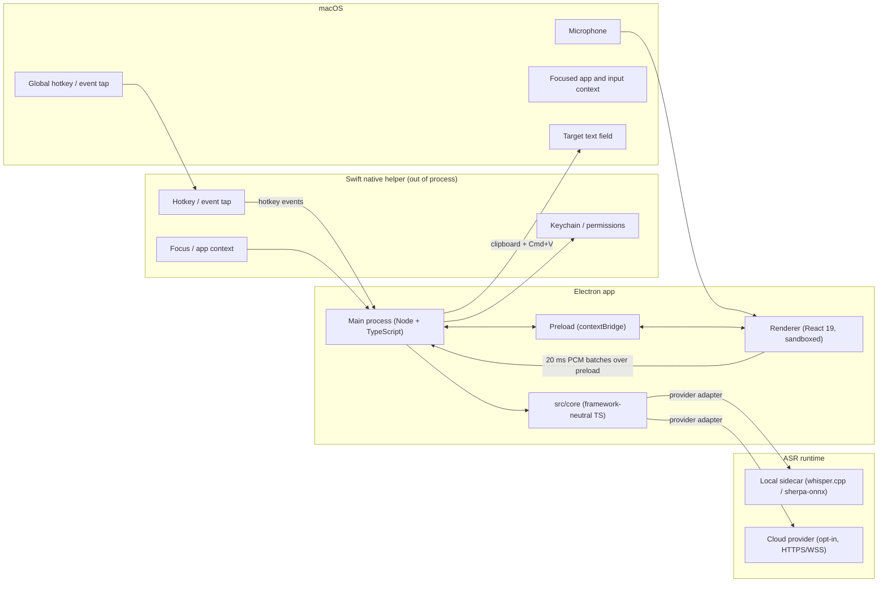

# JustSpeak v0.1 Architecture

- Status: Accepted (design baseline for v0.1)
- Date: 2026-10-26
- Decision owner: FD2008
- Depends on: [ADR-0001: Core boundary and repository strategy](ADR-0001-core-boundary.md), [ADR-0002: Technology stack](ADR-0002-tech-stack.md)
- Scope: process model, data flow, core/app boundary, security and privacy boundaries, and the Windows-later path. No implementation detail beyond what those decisions require.

## Context and constraints

JustSpeak v0.1 is a macOS-first desktop dictation app: press a hotkey, speak, and clean
text appears at the cursor of the focused application. The stack is Electron 45 +
TypeScript + React 19 + electron-vite 6 + a small Swift helper (ADR-0002).

The architecture must satisfy these constraints:

- **Native depth where it matters.** Global hotkeys, focused-application context, and
  text injection are OS-level operations. v0.1 microphone capture is the exception: it
  runs in the sandboxed renderer over Web Audio (AUDIO-PIPELINE.md, ADR-0003). OS
  operations live behind adapters, not spread through the TypeScript app.
- **A framework-neutral core.** ADR-0001 requires `src/core` to own the audio pipeline,
  VAD, ASR adapters, post-processing, model management, and the transcription settings
  schema, with no UI, platform, or OS-specific imports. The same core must serve
  SpeakPilot v0.2 and survive a future shell change.
- **Local-first by default.** Audio is processed on-device unless the user explicitly
  enables a cloud ASR provider. No vendor account is required.
- **Windows later without a rewrite.** Main, preload, renderer, and core stay portable;
  only the helper and packaging are platform-specific.
- **Small blast radius.** The renderer is sandboxed. It has Web Audio microphone access
  for capture, but no filesystem, helper, or provider-credential access.

This document is a design baseline. It intentionally does not decide packaging, signing,
auto-update, the local ASR runtime, or the Windows helper language; those are separate
cards.

## System overview



The helper is deliberately dumb: it moves audio and performs OS operations. It contains
no product policy, no network client, and no transcript logic.

## Options

### Option A — Core in the Electron main process, OS I/O in the Swift helper (chosen)

Main hosts the session state machine, imports `src/core`, and talks to the helper and the
ASR runtime. The renderer is UI-only.

**Pros:** simplest process topology; one authoritative session state; core is easy to
unit-test with fakes; no extra IPC hop for the pipeline; helper stays small.
**Cons:** the main process is single-threaded, so CPU-heavy post-processing can delay
window/IPC work.
**Mitigation:** keep the core process-agnostic and move it to `utilityProcess` or a worker
thread when measurements show main-thread contention.

### Option B — Core in an Electron `utilityProcess`

Main becomes a thin supervisor; the core runs in a separate Node process.

**Pros:** isolates CPU-heavy ASR post-processing and crashes from window management.
**Cons:** an extra IPC boundary, duplicated lifecycle logic, and more complex debugging
before there is measured evidence of contention.
**Decision:** defer. Design the core without Electron imports so this move is a wiring
change, not a rewrite.

### Option C — Audio capture in the renderer (`getUserMedia` + Web Audio)

**Pros:** no native audio code; works in any Electron app; familiar web APIs.
**Cons:** capture is tied to a renderer's lifetime; Chromium's audio stack adds latency
and its own permission path; the audio pipeline then straddles renderer and core, which
weakens the ADR-0001 boundary; push-to-talk and device switching are awkward.
**Decision:** the original baseline rejected this option for v0.1. The shipped v0.1
capture path is renderer `getUserMedia` + AudioWorklet (AUDIO-PIPELINE.md, ADR-0003), with
the helper capture path retained as the fallback. The cons above still apply: capture is
tied to a renderer's lifetime and the pipeline straddles renderer and core.

### Option D — Native addon via FFI (`node-ffi`/`koffi`) instead of a helper process

**Pros:** in-process calls; no IPC framing for small operations.
**Cons:** a native crash takes down the app; ABI coupling to Electron/Node; rebuilds on
every Electron upgrade; macOS permission attribution and Windows reuse get harder.
**Decision:** reject. The out-of-process helper is the crash and platform boundary.

### Option E — Cloud-only ASR for v0.1

**Pros:** smallest client, fastest path to high-quality transcription, no model
distribution.
**Cons:** contradicts the local-first differentiation; requires accounts, keys, and
network; privacy story becomes vendor-dependent.
**Decision:** reject as the default. Cloud providers remain an explicit opt-in adapter.

## Recommendation

Adopt **Option A**: a sandboxed React renderer that also hosts Web Audio capture, a
preload bridge, an Electron main process that hosts the session state machine, `src/core`,
and clipboard/paste injection, and an out-of-process Swift helper boundary for hotkeys and
focused-app context (helper capture remains the documented fallback). Keep the core free
of Electron imports so it can move to a utility process or a different shell later.

The boundary rules are the load-bearing part:

- Renderer: UI, display state, and the sandboxed Web Audio capture path; no Node, no
  helper, no provider keys.
- Preload: a narrow, typed, allowlisted bridge; no generic `ipcRenderer` exposure.
- Main: orchestration, validation, permissions, persistence, clipboard/paste injection,
  helper and ASR lifecycle.
- Core: pipeline and product logic; no Electron, DOM, or OS APIs.
- Helper: OS operations only; no product policy, no network.
- ASR runtime: local sidecar or opt-in cloud; never called directly by the renderer.

## Process Model

| Component | Runtime | Owns | Must not own |
|---|---|---|---|
| **Electron main** | Node.js + TypeScript | App lifecycle, windows/tray/menu, session state machine, core host, helper client, ASR provider selection, IPC validation, settings, history persistence, auto-update, clipboard/paste injection (v0.1) | Audio DSP internals, UI rendering, direct OS injection |
| **Preload** | Isolated world, TypeScript | Narrow typed API over `contextBridge`, event subscriptions, request/response wrappers | Business logic, Node module exposure, helper access |
| **Renderer** | Chromium, sandboxed, React 19 | Settings UI, history view, recording overlay, permission onboarding, error display, microphone capture (Web Audio + AudioWorklet) | Node APIs, file writes, helper access, provider keys, transcript post-processing |
| **`src/core`** | TypeScript, framework-neutral | Audio frame types, resampling/ring buffer, VAD/endpointing/chunking, ASR provider interfaces and adapters, post-processing, model catalog/manager, transcription settings schema, result/error types | Electron/React/DOM imports, OS APIs, window or IPC knowledge |
| **Swift helper** | Native macOS process (v0.1 helper not yet shipped) | Global hotkey/event tap, focused-app/input context, permission status, Keychain access; native text injection and `AVAudioEngine` capture are later/fallback paths | Product policy, network calls, transcript storage, UI |
| **ASR runtime** | Local child process (`transcribe-cli`) or remote service | Speech-to-text inference; v0.1 returns one final transcript | UI, injection, settings |
| **Storage** | Main process, local files | Settings, opt-in history, model metadata | Audio retention by default, plaintext secrets |

### Electron main

The main process is the supervisor and the only component that sees the whole session. It
validates every message from the renderer and the helper against a schema, enforces
timeouts, and owns the session state machine. It imports `src/core` and supplies platform
ports (clock, fetch, filesystem, model paths) so the core does not reach for globals.

The main process must never trust the renderer's sender frame; it checks the frame origin
and rejects messages from any window that is not the app's own UI.

### Preload

The preload exposes a small, explicit API: start/stop/cancel dictation, read state,
subscribe to state changes, open settings, and read/write validated settings. It does not
expose `ipcRenderer`, `require`, `process`, or a generic `invoke(channel, payload)`.

### Renderer

The renderer is a sandboxed React 19 app. It loads only bundled local content, has a
strict CSP, and cannot navigate away or open new windows. It renders the overlay
(idle/recording/transcribing/pasting/error), settings, history, and permission onboarding.
It also captures raw audio through Web Audio and never receives unredacted provider
credentials.

### `src/core`

The core is the reusable product logic described by ADR-0001. It is written as plain
TypeScript with injected ports, so it can run in the main process today and in a utility
process or a different shell later. It exposes:

- Audio pipeline: frame normalization, resampling to the ASR rate, ring buffer, VAD,
  endpointing, and chunking.
- ASR provider interface: capability declaration (v0.1 providers declare `streaming:
  false`), final result, cancellation, and a typed error taxonomy.
- Provider adapters: local sidecar and cloud HTTP/WebSocket implementations behind the
  same interface.
- Post-processing: punctuation/casing, filler removal, personal vocabulary, and optional
  LLM polish, each as composable steps.
- Model management: catalog metadata, download, checksum verification, and local path
  resolution (no UI).
- Transcription settings schema and validation, shared with SpeakPilot.

### Swift native helper

The helper is a small, long-lived process launched and supervised by main. It exposes a
versioned command set:

- `hello` / capability handshake (contract version, platform, available features).
- `startCapture`, `stopCapture`, `cancelCapture` for the helper-capture fallback (not the
  v0.1 default; renderer capture ships instead).
- `getFocusedApp` / `getInputContext` (app name, bundle id, focus state; no surrounding
  text by default).
- `injectText` (Accessibility insert, or clipboard + paste fallback).
- `getPermissionStatus` / `openPermissionSettings`.
- `registerHotkey` (optional; main may use Electron `globalShortcut` for simple toggles).

Transport is a versioned, length-prefixed frame protocol over stdio or a Unix domain
socket. Audio frames use a separate binary channel with backpressure, sequence numbers,
and a bounded buffer. A contract-version mismatch fails closed with a user-visible error;
it never silently degrades into wrong behavior.

### ASR runtime

Local inference runs in a child process (`transcribe-cli` from transcribe.cpp 0.4.1)
spawned by main, rather than inside the Electron main process itself. Each transcription
writes a temporary WAV, runs the CLI, and removes the WAV. Cloud providers are adapters in
`src/core` and require explicit user enablement. The renderer never talks to either.

### Storage

Settings are stored locally as validated JSON (or SQLite if history grows). Transcript
history is opt-in and local. Audio is not retained after a session by default; a failed
session may keep a bounded temporary clip only if the user has enabled retry. Secrets and
API keys live in the macOS Keychain through the helper (or Electron `safeStorage`), never
in renderer storage or plaintext config.

### Boundary enforcement

- Path aliases: `@core/*` is the only way app code imports core.
- Lint: `import/no-restricted-paths` (or dependency-cruiser) forbids `electron`, `react`,
  `react-dom`, and app paths inside `src/core`.
- Tests: a boundary test asserts that `src/core` has no Electron import and no DOM global
  access, and that all pipeline tests run with fake adapters.
- Review: any new core dependency must be justified as platform-neutral.

## Data Flow

```mermaid
sequenceDiagram
  participant U as User
  participant M as Electron main
  participant C as src/core
  participant A as ASR provider
  participant R as Renderer overlay

  U->>M: Hotkey (toggle or hold)
  M->>R: state = recording; start command
  R->>R: getUserMedia + AudioWorklet; PcmBatcher
  R-->>M: 20 ms PCM batches (16 kHz mono)
  M->>C: push batches
  C->>C: buffer and finalize the utterance
  C->>A: complete utterance (batch, final-only)
  A-->>C: final transcript
  C->>C: post-processing
  C-->>M: final text + metadata
  M->>M: clipboard write + Cmd+V
  M->>R: state = pasting / idle / error
```

### Session state machine

`idle → recording → transcribing → pasting → idle` (any state may enter `error`)

Any state can transition to `error` or back to `idle` on cancel. A short or silent
utterance ends in `idle` with a non-blocking notice, not an error dialog. A helper crash
or ASR timeout transitions to `error`, releases the microphone, and offers retry when the
audio buffer is still valid.

### Stage detail

1. **Hotkey.** Main registers a toggle hotkey via Electron `globalShortcut`. If
   push-to-talk is required, the helper's event tap provides press/release events with the
   same session API. Registration failure is surfaced during onboarding.
2. **Capture.** Main sends the start command to the renderer. The renderer opens
   `getUserMedia` with echo cancellation, noise suppression, and AGC disabled, creates a
   16 kHz `AudioContext`, and runs the `pcm-collector` worklet. The worklet posts Float32
   quanta with RMS and timestamps; `PcmBatcher` converts them to 20 ms Int16 batches that
   the renderer sends over the preload bridge. Main buffers accepted batches and stops
   accepting them once the session leaves recording.
3. **Finalization.** Core bounds the session buffer and, on stop, assembles the complete
   utterance. v0.1 is final-only: there is no overlapping-chunk streaming path and no
   partial hypothesis.
4. **ASR.** The selected provider adapter consumes the complete utterance. Local mode
   spawns `transcribe-cli`; cloud mode uses an opt-in HTTPS/WSS endpoint. The adapter
   returns one final transcript with latency and typed errors; v0.1 providers declare
   `streaming: false`. A fallback provider is allowed only if the user configured one.
5. **Post-processing.** Core applies punctuation/casing, filler removal, personal
   vocabulary, and optional LLM polish as separate steps. Each step is cancellable and
   records timing without transcript content. The final text preserves the user's language
   and does not invent content.
6. **Injection.** Main writes the final text to the clipboard and sends a synthesized
   Cmd+V through System Events (`src/main/injection.ts`). Snapshot/restore and ownership
   policy lives in `src/core/injection/paste.ts`: the previous clipboard is restored only
   when it still holds this transcript, and a failed paste leaves the transcript on the
   clipboard with a permission notice. Accessibility insertion is a later upgrade, not a
   v0.1 path (ADR-0003).
7. **Completion.** The overlay shows pasting and then returns to idle; history is written
   only if enabled, and metrics (duration, provider, latency, error class) are recorded
   without audio or transcript.

### Latency targets

These are design targets to validate with a performance harness, not measured results:

- Hotkey to recording indicator: ≤ 100 ms.
- End of speech to final text: p50 ≤ 1.5 s, p95 ≤ 3 s for a 10 s utterance on Apple
  Silicon with the local provider.
- Final text to injection: ≤ 100 ms.
- Cancel to microphone released: ≤ 100 ms.

If a target is missed, the first suspects are capture buffering, chunk size, sidecar
startup, and post-processing LLM calls. Do not hide latency behind optimistic partials.

## Core/App Boundary (ADR-0001)

ADR-0001 assigns the core the audio pipeline, model management, and transcription
settings schema; the shell owns UI, platform integration, permissions, hotkeys, text
injection, auto-update, and OS behavior. This architecture makes that concrete:

| Concern | `src/core` | App/shell |
|---|---|---|
| Audio frames, resampling, ring buffer | Yes | No |
| VAD, endpointing, chunking | Yes | No |
| ASR provider interface and adapters | Yes | Selects/enables providers |
| Post-processing steps | Yes | Displays results |
| Model catalog/download/checksums | Yes | Shows progress, asks consent |
| Transcription settings schema | Yes | Persists and renders settings |
| Microphone capture lifecycle and device selection | Yes (lifecycle; media ports injected) | Yes (renderer Web Audio) |
| Global hotkeys and permissions | No | Yes (main + helper) |
| Focused-app/input context | No | Yes (helper) |
| Text injection | Yes (paste policy, `src/core/injection/paste.ts`) | Yes (clipboard + Cmd+V adapter, main) |
| Windows, tray, menus, overlay | No | Yes (main + renderer) |
| History storage | No | Yes (main) |
| Auto-update, telemetry | No | Yes (main) |
| Keychain/secrets | No (port) | Yes (helper/safeStorage) |

Dependency direction is strictly **app → core**. The core depends only on injected ports
(clock, fetch, file access, model path resolution) and standard JavaScript. Tests supply
fake audio, fake ASR providers, and a fake clock. The core never imports Electron, React,
the DOM, the helper client, or any macOS API.

When SpeakPilot v0.2 arrives, it consumes the same core through the same interfaces. If
the repository is split per ADR-0001, the core becomes a versioned package without a
rewrite because this boundary already exists.

## Security and Privacy Boundaries

### Trust boundaries

| Boundary | Trust level | Rule |
|---|---|---|
| Renderer ↔ main | Renderer is not trusted with privileged operations | Sandbox, contextIsolation, typed preload, schema validation, sender-frame check |
| Main ↔ helper | Helper is trusted native code but minimal | Versioned frames, bounded sizes, timeouts, restart on crash, no network |
| Main ↔ local ASR sidecar | Trusted local binary, verified model files | Explicit path, checksum verification, process isolation, kill on idle |
| Main ↔ cloud ASR | External service, untrusted | Opt-in per provider, TLS, no keys in renderer, explicit data notice |
| App ↔ filesystem/Keychain | Privileged | Main/helper only; least privilege; no renderer access |

### Data classification

| Data | Sensitivity | Default handling |
|---|---|---|
| Raw audio | High | Processed locally; never persisted by default; cloud only on explicit opt-in; buffers cleared after finalization |
| Transcript text | High | Local history only if enabled; never in telemetry; redacted in logs by default |
| Focused-app context | High | v0.1 captures only app name/bundle id and focus state; no surrounding text, no screen text, no keystroke logging |
| Settings | Low | Local; validated; no secrets |
| API keys / tokens | High | Keychain or `safeStorage`; never renderer storage, never logs |
| Diagnostics/metrics | Low | Opt-in; aggregate; no content, no window titles, no URLs |

This is a deliberate differentiation from cloud-first dictation tools that capture
surrounding screen and input context. JustSpeak v0.1 does not read screen content or the
text around the cursor.

### Controls

- **Renderer hardening:** `sandbox: true`, `contextIsolation: true`, `nodeIntegration:
  false`, `webSecurity: true`, no remote content, strict CSP (`default-src 'self'`),
  navigation and `window.open` blocked, permission requests denied by default.
- **IPC:** allowlisted channels, typed payloads, runtime schema validation, size limits,
  sender-frame validation, and no generic invoke bridge.
- **Helper:** launched from a known app path, handshake-checked, frame-size bounded,
  timeouts on every command, no shell interpolation, no outbound network.
- **Cloud ASR:** disabled until the user selects a provider and accepts the data notice;
  TLS only; provider errors are redacted; the overlay shows when cloud processing is
  active.
- **Clipboard fallback:** snapshot and restore; skip injection into secure input fields;
  never log clipboard contents.
- **Permissions:** microphone requested only when dictation starts; Accessibility and
  Input Monitoring explained with a plain-language reason and a deep link to System
  Settings; no Screen Recording permission in v0.1.
- **Logs:** structured and content-redacted by default; a debug mode that captures
  transcript text requires an explicit warning and is off by default.
- **Local files:** app data directory with least-privilege permissions; optional history
  encryption at rest is an open question.
- **Updates:** signed and notarized builds; the update channel and signature verification
  are decided in the packaging card.

## Windows-Later Path

The Windows port must be a helper swap plus packaging, not a rewrite.

| Capability | macOS v0.1 | Windows later |
|---|---|---|
| Global hotkey | Electron `globalShortcut`; helper event tap for hold | `RegisterHotKey` or a low-level keyboard hook in the Windows helper |
| Audio capture | Renderer Web Audio + AudioWorklet, 16 kHz mono PCM (`AVAudioEngine` helper is the fallback) | WASAPI capture in the Windows helper, same frame format |
| Focused-app context | Accessibility API (`AXUIElement`) | UI Automation / Win32 foreground-window APIs |
| Text injection | Clipboard + ⌘V (v0.1); Accessibility insert is a later upgrade | `SendInput`, UI Automation, or TSF; clipboard + Ctrl+V fallback |
| Secure fields | Secure event input check | UIA password-field detection / secure desktop checks |
| Permissions | Microphone TCC, Accessibility, Input Monitoring | Microphone privacy settings; no TCC equivalent |
| Secrets | Keychain | DPAPI / Credential Manager |
| Packaging | DMG + notarization (separate card) | MSIX/NSIS + signing (separate card) |
| UI and core | Electron + `src/core` | Unchanged |

Rules for the port:

- The helper contract is the only platform-specific interface. Version it from day one
  and test it with a fake helper on both platforms.
- The core and renderer must not branch on `process.platform` for product behavior; they
  consume capability flags reported by the helper.
- Feature gaps (for example, no Accessibility insert) degrade to a documented fallback,
  not a crash.
- The Windows helper language is deliberately not decided here (separate card). The
  contract uses JSON and binary frames, not Swift types.
- CI gains a Windows job only when the Windows helper exists; until then, contract tests
  run against the fake helper.

## Failure Handling and Degradation

| Failure | Behavior |
|---|---|
| Microphone permission denied | Onboarding explains why and links to System Settings; no session starts; no crash |
| Accessibility/Input Monitoring denied | Dictation still records and transcribes; the paste fails with a permission notice and the transcript stays on the clipboard |
| Helper crash or hang | Kill and restart the helper for OS operations; the renderer stops capture and releases the mic; show retry if audio is still valid |
| ASR timeout or network failure | Keep the buffered audio, offer retry, optionally fall back to a configured provider; never silently drop the transcript |
| Local model missing or corrupt | Prompt to download/repair; verify checksums before use |
| Short or silent utterance | Return to idle with a non-blocking notice; do not send empty text to the target app |
| Secure input field focused | Not detected in v0.1; the clipboard + Cmd+V path still attempts the paste. Secure-input detection is a later hardening item |
| Injection partially succeeds | Report the failure; do not paste a second copy automatically |
| App quits mid-session | Release the mic, discard the buffer, and do not write a partial history entry |

## Testing Strategy

- **Core unit tests:** fake audio frames, fake VAD/ASR adapters, fake clock; deterministic
  chunker and post-processing tests; no Electron or OS dependencies.
- **Boundary tests:** assert `src/core` imports no Electron/React/DOM and that app code
  imports core only through the documented entry points.
- **Contract tests:** main ↔ helper against a fake helper implementing the versioned
  protocol, including version mismatch, oversized frames, timeouts, and crash/restart.
- **Renderer tests:** component tests for overlay states, settings validation, permission
  onboarding, and error surfaces.
- **Integration smoke:** a mocked-ASR end-to-end run from hotkey to injection using a test
  target field; no real microphone required in CI.
- **Privacy tests:** logs contain no transcript text; no network calls occur with cloud
  providers disabled; audio buffers are cleared after finalization.
- **Performance harness:** measure hotkey-to-indicator, end-of-speech-to-final,
  end-to-final injection, idle/recording RSS, and installer size against the targets above.

## Sources

Accessed 2026-10-26.

- [ADR-0001: Core boundary and repository strategy](ADR-0001-core-boundary.md)
- [ADR-0002: Technology stack for JustSpeak v0.1](ADR-0002-tech-stack.md)
- [README.md](../README.md)
- [docs/ROADMAP.md](ROADMAP.md)
- Electron process model: https://www.electronjs.org/docs/latest/tutorial/process-model
- Electron security checklist: https://www.electronjs.org/docs/latest/tutorial/security
- Electron `utilityProcess`: https://www.electronjs.org/docs/latest/api/utility-process
- Electron `contextBridge`: https://www.electronjs.org/docs/latest/api/context-bridge
- Electron `globalShortcut`: https://www.electronjs.org/docs/latest/api/global-shortcut
- Electron `safeStorage`: https://www.electronjs.org/docs/latest/api/safe-storage
- Apple AVAudioEngine: https://developer.apple.com/documentation/avfaudio/avaudioengine
- Apple Accessibility API: https://developer.apple.com/documentation/applicationservices/axuielement
- Apple TN2150, Secure Event Input: https://developer.apple.com/library/archive/technotes/tn2150/_index.html
- Typeless native-helper evidence (third-party reverse engineering):
  https://github.com/zephyr4123/speakmore/blob/main/targets/typeless/docs/00-overview.md
- Wispr Flow native-helper evidence (third-party reverse engineering):
  https://github.com/wispr-flow-linux/wispr-flow-linux/blob/main/CLAUDE.md
- Tauri system-webview alternative: https://v2.tauri.app/start/

Apple platform APIs are cited as the intended integration surface; no code from those
pages or from competitors is copied. Competitor evidence is used only to validate the
architecture shape.

## Open Questions

1. **Core hosting:** when does the pipeline move to `utilityProcess` or a worker thread?
   Decide from measured main-thread contention, not speculation.
2. **Audio capture fallback:** the renderer `getUserMedia` path is shipped; the latency and
   quality spike, and the helper `AVAudioEngine` fallback comparison, remain open.
3. **Local ASR runtime:** whisper.cpp sidecar versus sherpa-onnx versus another engine;
   separate card, with quality and latency measurements.
4. **Partials in v0.2:** v0.1 is final-only (`streaming: false`); which provider adds
   partial hypotheses, and what the UX should show while waiting, remains open.
5. **Injection strategy:** how often Accessibility insert works across target apps versus
   clipboard fallback; build a compatibility matrix.
6. **Minimum macOS version:** constrained by Electron 45 support and the Swift APIs used.
7. **History storage and encryption:** JSON versus SQLite, retention defaults, and
   encryption at rest.
8. **Windows helper language and contract details:** separate card; keep the contract
   language-neutral.
9. **Packaging, signing, notarization, and auto-update:** separate card.
10. **Overlay implementation:** transparent always-on-top BrowserWindow versus a native
    panel, including focus-stealing behavior.
11. **Telemetry scope:** opt-in only; define the exact metrics and the redaction rules.
12. **Multi-device and phone-as-microphone:** explicitly out of scope for v0.1; revisit
    after the desktop path is stable.
