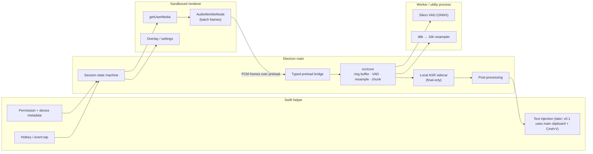

# Audio Capture, VAD, and Streaming Pipeline Design for JustSpeak v0.1

- Status: Accepted design baseline. Capture path is frozen; VAD model parameters, frame
  size, and chunk size remain provisional until the audio spike/benchmark.
- Date: 2026-10-26
- Decision owner: FD2008
- Depends on: [ADR-0001: Core boundary](ADR-0001-core-boundary.md),
  [ADR-0002: Technology stack](ADR-0002-tech-stack.md),
  [ARCHITECTURE.md](ARCHITECTURE.md), [ASR-RESEARCH.md](ASR-RESEARCH.md)
- Scope: macOS v0.1 microphone capture, voice activity detection (VAD), buffering,
  resampling, chunking/streaming, latency budget, and the streaming seam for a future
  cloud provider. No code, packages, models, or audio benchmarks are included in this
  card.
- Evidence tags: **E2** = primary code/config/artifact inspected directly for this
  document (repository file, package manifest, license text, model metadata).
  **E3** = web/third-party documentation or third-party reverse engineering. E3 claims
  must be re-checked before they become implementation facts. Access date: 2026-10-26.

## Context and Constraints

JustSpeak v0.1 is a macOS-first desktop dictation app. The user presses a hotkey, speaks,
and clean text appears at the cursor of the focused application. The frozen stack is
Electron 45 + TypeScript + React 19 + electron-vite 6 + a small Swift helper
(ADR-0002). `src/core` owns the audio pipeline, VAD, resampling, chunking, ASR adapters,
and post-processing, and must stay free of Electron, React, DOM, and OS imports
(ADR-0001).

The following decisions are frozen for this design:

- Web Audio API in the Electron renderer is the default capture path.
- The target audio format is **16 kHz mono, 16-bit PCM**.
- v0.1 does **not** require live partial transcripts. The default ASR mode is
  final-only local processing.
- The Swift helper remains responsible for OS-level work: global hotkey/event tap,
  focused-application context, permission status, and device metadata. Text injection
  ships in v0.1 as the main-process clipboard + `Cmd+V` path (ADR-0003); direct
  Accessibility insertion is a later upgrade.
- No paid services are required. Cloud ASR remains an explicit opt-in adapter.
- The exact VAD model and chunk size are validated in the audio spike, not fixed here.

**Agreement with the accepted architecture.** ARCHITECTURE.md Option C originally
rejected renderer capture for v0.1 and assigned `AVAudioEngine` capture to the Swift
helper; the frozen card for this document overrode that default. ARCHITECTURE.md and
ADR-0003 have since been amended to record the shipped renderer Web Audio capture path,
with the Swift helper supplying device/permission support, and ADR-0003 item 8 tracks the
open 16 kHz exception. The helper capture path remains the
comparator and the documented fallback if the renderer path misses the gates in
[Validation gates](#validation-gates-audio-spike).

Design constraints that drive the options:

| ID | Constraint | Consequence |
|---|---|---|
| C1 | Final latency matters more than partials: stop to final text p50 < 1.5 s, p95 ≤ 3 s for a 10 s utterance on Apple Silicon (ARCHITECTURE.md) | No streaming transport on the local critical path; keep the buffer and inference path short |
| C2 | Local-first and no required account | Default path is on-device; Opus/WebSocket transport is a seam, not a v0.1 dependency |
| C3 | 16 kHz mono target | Resampling must be explicit and testable; device rate is usually 48 kHz |
| C4 | `src/core` owns VAD, resampling, ring buffer, and chunking | Capture is a shell concern; DSP is a core concern behind ports |
| C5 | Sandboxed renderer, strict CSP, no remote content (ARCHITECTURE.md) | Renderer capture requires a narrow preload bridge and permission policy changes |
| C6 | Windows later without a rewrite | Prefer a capture path that has a Chromium equivalent on Windows; keep the helper contract platform-neutral |
| C7 | Solo TypeScript developer | Minimize native audio code and ABI coupling; one audio stack is easier to test |

## Options

### Capture options

#### Option A — Web Audio API + AudioWorklet in the Electron renderer (default)

**Shape.** The renderer calls `navigator.mediaDevices.getUserMedia({ audio: ... })`,
routes the `MediaStream` through an `AudioContext` and an `AudioWorkletNode`, batches
PCM frames in the worklet, and sends them over a narrow preload bridge to the main
process. Main pushes frames into `src/core`. The worklet is the only audio-thread code;
it must not allocate, block, or perform network I/O.

**Latency.** The `AudioWorklet` receives 128-frame render quanta (128 samples is the Web
Audio render quantum; at 16 kHz that is 8 ms, at 48 kHz about 2.7 ms). Batching several
quanta into 20–32 ms frames reduces IPC overhead. End-to-end capture latency is
dominated by device open time, Chromium's audio service buffering, and the chosen batch
size, not by the worklet itself. `AudioContext.baseLatency` and
`AudioContext.outputLatency` describe output paths and are not a capture-latency
measurement; measure the first `process()` callback against the hotkey timestamp.

**Permissions.** macOS TCC attributes the microphone prompt to the Electron app bundle.
The app needs `NSMicrophoneUsageDescription` in `Info.plist`, and the main process must
grant microphone permission to its own renderer through
`session.setPermissionRequestHandler` (and preferably `setPermissionCheckHandler`). The
renderer cannot request the microphone if the app-level policy denies it. Permission
state is queryable through the helper (`AVCaptureDevice.authorizationStatus(for:)`) and
deep-linkable to System Settings. Development builds and signed builds can have separate
TCC identities, which is a recurring onboarding problem.

**Device selection.** `navigator.mediaDevices.enumerateDevices()` lists audio inputs;
`deviceId` in the `getUserMedia` constraints selects one. Labels become available only
after permission is granted. `devicechange` signals hot-plug and default-device changes.
Chromium's `deviceId` is origin-scoped and is not the CoreAudio device UID, so the helper
may need to report a stable platform identifier and a human-readable name for settings
and diagnostics. Device selection is workable but less precise than native CoreAudio
enumeration.

**Echo cancellation, noise suppression, AGC.** `getUserMedia` accepts
`echoCancellation`, `noiseSuppression`, and `autoGainControl` constraints. Chromium
defaults these to enabled for microphone capture in many configurations; the design
sets all three to `false` and verifies the applied values with
`MediaStreamTrack.getSettings()`. The reason is the same one Typeless documents:
recognition models are trained on raw audio, and front-end processing can remove cues
the model uses. The trade-off is that speaker playback can bleed into the microphone;
echo cancellation should be a user-visible setting, not an invisible default. macOS may
also apply system-level voice isolation to some audio routes; verify the actual route
during the spike.

**16 kHz target.** Two approaches work:

1. Request an `AudioContext` at 16 kHz and let Chromium resample from the device rate.
   Typeless does this with a 16 kHz `AudioContext`, and it is the shortest code path.
2. Capture at the device's native rate (usually 48 kHz) and resample to 16 kHz in
   `src/core` with a deterministic polyphase FIR (3:1 for 48 kHz). This preserves
   ADR-0001's ownership of resampling, is unit-testable with synthetic tones, and avoids
   depending on Chromium's opaque resampler.

The recommendation below chooses approach 2, with approach 1 as the fallback if the
spike shows the core resampler is too costly or the device cannot deliver native rate
through the renderer. Either way, verify the result with a sine sweep and a speech
sample: check the effective sample rate, alias products above 8 kHz, and CPU cost.

**Pros.** No native audio code; one TypeScript audio stack; works on Windows via the same
Chromium APIs; fast iteration; the worklet isolates audio-thread code from React; the
same PCM format feeds the core on both platforms.

**Cons.** Capture is tied to a renderer's lifetime; Chromium's audio service and
permission policy sit between the app and the device; device selection is less precise
than CoreAudio; echo cancellation/noise suppression behavior is browser-controlled; the
renderer now handles raw audio, which contradicts the current ARCHITECTURE.md boundary;
renderer crash or reload loses the session buffer.

**Evidence.** E3: Typeless uses `getUserMedia` + `AudioWorkletNode` in its overlay
renderer, a 16 kHz `AudioContext`, 1024-sample (64 ms) worklet batches, and echo
cancellation/noise suppression/AGC explicitly disabled. E2: SpeakType ships a Silero VAD
ONNX asset and a main-process VAD module, showing that an Electron competitor runs
neural VAD outside the audio thread; its capture path was not claimed here. E3: MDN Web
Audio and AudioWorklet documentation for the render quantum, `AudioContext` sample rate,
and `getUserMedia` constraints.

#### Option B — Swift helper with AVAudioEngine

**Shape.** The helper owns `AVAudioEngine`, taps the input node with a small buffer,
converts to 16 kHz mono with `AVAudioConverter`, and streams PCM frames to main over the
versioned binary IPC contract. This is the shape accepted by ARCHITECTURE.md Option A.

**Latency.** Best control: native device open, small tap buffers, no Chromium audio
service in the path. `installTap(onBus:bufferSize:format:block:)` buffer size and the
converter determine the frame cadence. The cost is the helper IPC hop, which is small
with length-prefixed binary frames and backpressure.

**Permissions.** Native `AVCaptureDevice.requestAccess(for: .audio)` and TCC; the helper
can report status and open the correct Settings pane. This is the most predictable
permission UX.

**Device selection.** Full CoreAudio enumeration: stable device UIDs, transport type,
default-device changes, built-in versus Bluetooth, lid state. This is materially better
than renderer `enumerateDevices()`.

**Echo cancellation, noise suppression, AGC.** `AVAudioInputNode` voice processing
(`setVoiceProcessingEnabled`) provides Apple's echo cancellation and processing, and
`AVAudioConverter` handles format conversion. These can be enabled per session and are
not subject to Chromium's defaults. For raw-audio ASR the default should still be off,
but the helper gives a real choice.

**16 kHz target.** `AVAudioConverter` from the input node's format to 16 kHz mono
16-bit is direct and well supported. This is the cleanest resampling path of the three
options.

**Pros.** Best latency, device control, permission behavior, and processing control;
native crash isolation; strong macOS fit; no renderer audio access; aligns with
ARCHITECTURE.md and ADR-0002.

**Cons.** Contradicts the frozen renderer-capture default; requires native audio code
and a second implementation on Windows (WASAPI); more Swift surface to maintain; the
helper becomes responsible for a high-bandwidth stream, so the IPC contract and
backpressure need care; iteration is slower for a TypeScript developer.

**Evidence.** E2: ADR-0002 chooses the Swift helper and names `AVAudioEngine`; it also
lists audio capture as a helper responsibility. E3: Typeless ships four Swift dynamic
libraries, one of which covers audio devices, but its capture runs in the renderer, not
in that library. E3: Apple `AVAudioEngine`, `AVAudioConverter`, and
`AVAudioInputNode` voice-processing documentation.

#### Option C — Node native audio in the main or utility process

**Shape.** A native addon such as PortAudio/`naudiodon` or a vendor SDK captures audio
inside the Node process and pushes frames directly into the core.

**Latency.** Comparable to the helper, but callbacks run in the Node process; CPU-heavy
DSP can contend with session state and IPC. Native addon ABI must match Electron's Node
ABI and be rebuilt on Electron upgrades.

**Permissions.** The microphone prompt is attributed to the app, but there is no native
helper to query or deep-link permission state cleanly. macOS TCC behavior for a native
addon inside Electron is less predictable than for a helper or the renderer.

**Device selection.** Depends on the addon; PortAudio enumeration is workable but less
rich than CoreAudio, and Bluetooth/lid state are not first-class.

**Echo cancellation, noise suppression, AGC.** Weakest option: PortAudio does not give
Apple voice processing, and implementing AEC/NS/AGC yourself is out of scope.

**16 kHz target.** The addon can request 16 kHz, but device support varies and drift
handling is on the app.

**Pros.** No renderer audio access; direct core feed; no Chromium audio service.

**Cons.** Native ABI coupling to Electron, rebuilds on every Electron upgrade, weaker
permission and device control, no voice processing, crash takes down the process,
Windows path requires another addon. Rejected for v0.1.

**Evidence.** E3: general documentation for PortAudio/Node native audio and Electron
native-module ABI constraints; ADR-0002 already rejected a native addon via FFI for
crash and ABI reasons.

### VAD options

VAD answers two questions: when does speech start, and when has it ended. In v0.1 it is
used for endpointing and for rejecting silent/short utterances, not for live captions.
A VAD false positive sends noise to ASR and can produce a hallucinated transcript; a
false negative clips the first or last word. Both are user-visible quality failures.

#### Silero VAD

- **What it is.** A small pre-trained neural VAD with PyTorch and ONNX distributions.
  The ONNX model file is 2,327,524 bytes (about 2.2 MB) in the upstream repository
  (E2, file size).
- **License.** MIT for the repository and the model, verified from the raw LICENSE file
  (E2).
- **Sample rates and frame size.** Supports 8 kHz and 16 kHz; the standard 16 kHz
  interface consumes 512-sample windows (about 32 ms). Confirm the exact input shape of
  the chosen ONNX export in the spike, because community exports vary.
- **False positives.** Trained on a large multilingual corpus and reported to be robust
  across noise and domains; still capable of triggering on music, television speech, or
  keyboard transients. Mitigations: minimum speech duration, hysteresis thresholds, and
  an ASR empty/hallucination check.
- **Latency.** Upstream reports under 1 ms per 30+ ms audio chunk on a single CPU thread
  (E2, upstream README claim). Endpointing latency is dominated by the trailing-silence
  window (typically 300–500 ms), not by inference.
- **CPU and memory.** Small model, low per-frame cost; ONNX Runtime adds a native
  dependency. Peak RSS is modest compared with ASR, but must be measured.
- **Integration.** Runs through `onnxruntime-node` in a worker or utility process, or
  through the sherpa-onnx sidecar if that runtime exposes Silero VAD. Behind a
  `VadDetector` port in `src/core`, it is unit-testable with synthetic frames.
- **Evidence.** E2: Silero LICENSE, README (8k/16k, sub-millisecond claim), and ONNX
  file size. E2: SpeakType ships `desktop/resources/vad/silero_vad.onnx` and
  `desktop/src/main/vad.ts`, and its README describes an optional on-device Silero VAD
  for auto-stop and hallucination filtering. E3: ONNX Runtime documentation.

#### WebRTC VAD

- **What it is.** The GMM-based VAD from the WebRTC project, exposed as a small C API
  with aggressiveness modes 0–3. It accepts 10, 20, or 30 ms frames at 8, 16, 32, or
  48 kHz.
- **License.** BSD-style WebRTC license; compatible with an MIT app (E3).
- **False positives.** Higher than a neural VAD in noise, music, and non-speech
  transients; the aggressiveness mode trades missed speech for false triggers. It was
  designed for real-time communications gating, not for dictation quality.
- **Latency and CPU.** Very low; frame-level decisions, negligible CPU. This is its main
  advantage.
- **Integration.** Requires a native binding or a Swift/C implementation; a native
  addon brings Electron ABI and crash concerns. It does not exist as a first-class
  TypeScript module without a binding.
- **Verdict.** A reasonable low-cost baseline for the spike, not the default.

#### Energy-based gating

- **What it is.** RMS or peak energy with hysteresis, optionally plus zero-crossing
  rate.
- **False positives.** High in fans, air conditioning, music, and traffic; it cannot
  distinguish speech from noise. It is useful only as a "microphone is dead or muted"
  detector. Typeless's own silence check is exactly this: it samples the waveform every
  100 ms and treats any deviation from the midpoint as sound, which catches a muted or
  wrong device but is not speech detection (E3).
- **Latency and CPU.** Immediate and nearly free.
- **Integration.** Trivial, no dependencies, easy to unit-test.
- **Verdict.** Keep as a pre-gate and a device-health check; do not use it as the
  endpointing VAD.

### Chunking and streaming options

#### Final-only local processing (v0.1 behavior)

Capture streams continuously into a ring buffer. VAD endpoints the utterance. On stop
(or endpoint), the complete utterance is sent to the local ASR sidecar, post-processed,
and injected. No audio leaves the machine, no WebSocket is required, and the provider
interface is final-only. This matches the frozen "no live partials" decision and the
observed Typeless behavior, where the server does not return transcript text during
recording even though it receives chunks (E3).

The cost is tail latency: all inference happens after stop. For a 10 s utterance,
SenseVoice-class non-autoregressive inference is expected to keep p50 under 1.5 s on
Apple Silicon, but this must be measured. Long utterances need segmentation because
SenseVoice has a 30-second per-segment limit (ASR-RESEARCH.md).

#### Three-second Opus chunks over WebSocket (Typeless pattern)

Typeless cuts the recording into 3-second chunks, encodes each as Opus (16 kHz mono,
32 kbps VBR, 20 ms frames, complexity 9), and sends each chunk over a WebSocket with a
`set_audio_chunk_info` message. At stop it sends the final chunk and `end_audio`, and
races the WebSocket result against an HTTP fallback that uploads the complete audio. In
four captured sessions of up to 13 seconds, the final text arrived 1.4–1.9 seconds
after stop; the server acknowledged chunks but did not stream transcript text (E3).

This pattern is well suited to a cloud provider: upload time is amortized across the
utterance, the final chunk is small, and the HTTP fallback covers a broken WebSocket.
It is not needed for a local final-only path, and it adds an encoder, a transport, and
a second failure surface. It also does not create partial transcripts by itself; Typeless
returns the transcript only after the audio is complete.

#### Hybrid: final-only default with a streaming seam

Keep the v0.1 behavior final-only, but define the provider capability flag and transport
seam so a future cloud adapter can use streaming chunks. The core interface already
carries a `streaming` capability flag (ASR-RESEARCH.md); v0.1 providers declare
`streaming: false`. A streaming provider would receive 3-second Opus chunks over
WebSocket and return partial hypotheses that the v0.1 UI ignores. No streaming code is
required in v0.1.

#### HTTP fallback

For a cloud provider, the Typeless pattern is the reference: prepare a complete-audio
HTTP request while waiting for the WebSocket result, send it only if the WebSocket has
not answered within a short grace period, and cancel the loser when one wins (E3). For
the local default there is no HTTP path; the sidecar call is the only path. If a cloud
adapter is enabled later, the fallback must respect the same no-silent-failover rule as
ASR-RESEARCH.md: never send audio to a provider the user did not enable for the session.

#### Partial versus final transcripts

v0.1 shows recording → transcribing → done. It does not display partial text, and the
provider contract returns only a final result. This avoids a class of UX bugs
(rewriting text under the cursor, flicker) and keeps the latency target honest. Partial
transcripts are a v0.2 question and require a streaming provider capability, a stable
partial-text policy, and a different UI.

### Candidate architectures

#### Architecture 1 — Renderer Web Audio + AudioWorklet + core in main + Swift helper for OS I/O (chosen)

Capture is in the renderer; VAD/resampling/chunking live in the core behind ports; the
worker or utility process isolates CPU-heavy DSP; the helper does only OS operations.
This keeps the TypeScript audio stack and the Windows path, at the cost of renderer
lifetime coupling and a boundary change.

#### Architecture 2 — Swift helper capture (AVAudioEngine) + core in main

The helper captures 16 kHz PCM and streams it over the binary IPC contract; main and
core are unchanged. Best native behavior, but contradicts the frozen capture default,
requires native audio code, and does not reuse the renderer path on Windows. Retained as
the fallback if Architecture 1 fails the latency or quality gates.

#### Architecture 3 — Node native audio in main or utility

A native addon captures audio in the Node process. No renderer audio access, but ABI
coupling, weaker device/permission control, and no voice processing. Rejected.

#### Architecture 4 — Renderer capture with helper voice processing (future variant)

The renderer captures, but the helper provides device/permission metadata; optionally,
the helper could apply voice processing if echo cancellation becomes a requirement. This
is a future hybrid, not a v0.1 implementation.

## Comparison

Scores are 1 (worst) to 5 (best) and are the author's judgment informed by the evidence,
not measured benchmarks. Weights reflect the frozen product priorities: solo TypeScript
velocity, the frozen renderer-capture default, Windows-later reuse, and latency. Where
native-only criteria would favor the helper, that is called out in the reading notes.

### Capture comparison

| Criterion | Weight | A: Renderer Web Audio + AudioWorklet | B: Swift helper AVAudioEngine | C: Node native audio |
|---|---:|---:|---:|---:|
| Integration velocity / one TypeScript stack | 0.30 | 5 | 2 | 3 |
| Windows-later reuse | 0.20 | 5 | 2 | 3 |
| Capture latency and jitter control | 0.20 | 3 | 5 | 3 |
| Device selection and permission UX | 0.10 | 3 | 5 | 2 |
| Echo cancellation / NS / AGC control | 0.05 | 3 | 5 | 1 |
| 16 kHz conversion control | 0.05 | 4 | 5 | 3 |
| Crash isolation and lifecycle | 0.05 | 3 | 5 | 1 |
| Architecture boundary fit | 0.05 | 2 | 5 | 3 |
| **Weighted total** | **1.00** | **4.00** | **3.50** | **2.70** |

Reading the matrix:

- Option B wins every native capture criterion: latency, device control, permissions,
  voice processing, crash isolation, and boundary fit. If the product were macOS-only
  and native-first, B would be the correct default.
- Option A wins because the frozen decision prioritizes one TypeScript audio stack, the
  Windows path, and implementation velocity. It is not a claim that renderer capture is
  technically superior; it is a product trade-off that must be validated against the
  latency gates.
- Option C has no category where it beats both alternatives. Its only advantage (no
  renderer audio access) is outweighed by ABI coupling and weak device/permission
  control.
- The fallback is explicit: if A misses the gates in the audio spike, Architecture 2
  (B) becomes the capture path, and the rest of the pipeline is unchanged.

### VAD comparison

| Criterion | Weight | Silero VAD (ONNX) | WebRTC VAD | Energy gating |
|---|---:|---:|---:|---:|
| False positives in noise / non-speech | 0.35 | 5 | 2 | 1 |
| Endpointing latency | 0.20 | 4 | 5 | 5 |
| CPU and memory | 0.15 | 4 | 5 | 5 |
| Integration and testability | 0.15 | 3 | 3 | 5 |
| License, model size, portability | 0.15 | 5 | 5 | 5 |
| **Weighted total** | **1.00** | **4.35** | **3.65** | **3.60** |

Reading the matrix:

- Silero wins because dictation quality depends on not sending noise to ASR. Its
  per-frame latency is already below the trailing-silence window, so the latency
  advantage of WebRTC VAD does not translate into a user-visible win.
- WebRTC VAD is a useful baseline and a low-CPU escape hatch, but its false-positive
  behavior in noise is the wrong trade-off for dictation.
- Energy gating is only viable as a microphone-health check. It cannot distinguish
  speech from noise, as Typeless's own "silence" detector illustrates.
- The exact Silero variant, thresholds, and execution location are validation items,
  not frozen here.

### Streaming comparison

| Criterion | Weight | Final-only local | 3 s Opus chunks over WS + HTTP fallback | Hybrid: final-only + streaming seam |
|---|---:|---:|---:|---:|
| v0.1 fit (no partials, local-first) | 0.35 | 5 | 2 | 5 |
| Latency | 0.20 | 4 | 5 | 4 |
| Complexity and failure surface | 0.20 | 5 | 2 | 3 |
| Privacy and offline behavior | 0.15 | 5 | 1 | 5 |
| Extensibility to cloud/partials | 0.10 | 3 | 5 | 5 |
| **Weighted total** | **1.00** | **4.60** | **2.75** | **4.40** |

Reading the matrix:

- Final-only local wins for v0.1: no transport, no encoder on the critical path, no
  audio leaves the device, and it matches the frozen no-partials decision.
- The Typeless streaming pattern is excellent for a cloud-first product, but it adds an
  encoder, a WebSocket lifecycle, and an HTTP race that a local final-only path does not
  need. It is not required to satisfy the latency target if local inference is fast.
- The chosen shape is the hybrid row in behavior: final-only in v0.1, with the provider
  capability flag and transport seam defined so streaming can be added without a
  pipeline rewrite.

### Architecture comparison

| Criterion | Weight | 1: Renderer capture + helper OS I/O | 2: Helper capture | 3: Node native capture |
|---|---:|---:|---:|---:|
| Integration velocity / TypeScript reuse | 0.30 | 5 | 2 | 3 |
| Windows-later reuse | 0.20 | 5 | 2 | 3 |
| Latency and jitter | 0.15 | 3 | 5 | 3 |
| Device selection and permissions | 0.10 | 3 | 5 | 2 |
| Crash isolation | 0.10 | 3 | 5 | 1 |
| Architecture boundary fit | 0.15 | 2 | 5 | 3 |
| **Weighted total** | **1.00** | **3.85** | **3.50** | **2.70** |

Architecture 1 is chosen for the same product reasons as capture Option A. Architecture
2 is the fallback and the native benchmark. Architecture 3 is rejected.

## Recommendation

Adopt **Architecture 1**: renderer Web Audio capture with AudioWorklet, a framework-
neutral core in the main process (or a utility process when measurements demand it), a
Silero VAD worker, final-only local ASR, and the Swift helper for OS-level operations.
Concretely:

1. **Capture path.** Renderer `getUserMedia` → `AudioContext` → `AudioWorkletNode`
   ("pcm-collector"). The worklet posts raw Float32 render quanta (plus RMS and a capture
   timestamp); the pure `PcmBatcher` in `src/core/capture/pcm-batcher.ts` clamps them and
   emits 20 ms Int16 batches (320 samples at 16 kHz), which the renderer forwards over a
   narrow, allowlisted preload channel to main. The wiring lives in
   `src/renderer/src/App.tsx` and `src/core/capture/capture-controller.ts`; the batch
   contract is in `openspec/specs/audio-capture/spec.md`. No audio is written to disk,
   logged, or sent to the network by the renderer. The renderer does not get Node,
   filesystem, helper, or provider-key access.

2. **Format and resampling.** Target 16 kHz mono, 16-bit PCM. Capture at the device's
   native rate (typically 48 kHz) and resample to 16 kHz in `src/core` with a
   deterministic polyphase FIR (3:1 when the source is 48 kHz). Keep the resampler pure
   TypeScript and unit-test it with sine sweeps and synthetic speech. If the spike shows
   the core resampler is too costly on the main thread, move the core to a worker or
   utility process; do not silently fall back to Chromium's resampler without measuring
   the quality difference. The `AudioContext({ sampleRate: 16000 })` path is the
   documented fallback, not the default, because it hides resampling behind the browser
   and weakens ADR-0001's ownership of the DSP. **Implementation status:** the shipped
   renderer path currently creates a 16 kHz `AudioContext` and rejects other rates
   (`src/renderer/src/App.tsx`, `src/core/capture/capture-controller.ts`); that deviation
   is recorded as an open item in ADR-0003 (Open questions item 8), not ratified here.

3. **Frames and ring buffer.** Batch 320 samples at 16 kHz (20 ms) or 480 samples
   (30 ms); do not copy the Typeless 64 ms batch, which adds avoidable stop latency on a
   local final-only path. Maintain a pre-roll ring buffer of 300 ms so the first
   phoneme is not clipped when capture starts after the hotkey. Bound the session buffer
   at 120 seconds of 16 kHz mono Int16 audio (about 3.84 MB); on overflow, stop the
   session with a clear "too long" notice instead of silently dropping audio. Zero
   buffers after finalization.

4. **VAD.** Use Silero VAD (ONNX, MIT) behind a `VadDetector` port in `src/core`, run in
   a worker or utility process through `onnxruntime-node` for v0.1. Start with 512-sample
   (32 ms) windows at 16 kHz, start threshold 0.5, end threshold 0.35, minimum speech
   250 ms, trailing silence 400 ms, and 200 ms speech padding; tune these in the spike.
   Keep an energy gate only as a microphone-dead/muted check. Evaluate the sherpa-onnx
   built-in VAD in the spike; if it matches Silero quality and avoids a second native
   dependency, prefer it. WebRTC VAD is a benchmark baseline, not the default.

5. **Endpointing and long utterances.** Manual stop always ends the utterance. In
   hands-free mode, VAD trailing silence ends it. For utterances longer than SenseVoice's
   30-second segment limit, split at VAD-detected silence into segments of at most 30
   seconds; hard-split at 29 seconds only when no silence exists, and accept a small
   boundary-risk on that path. Transcribe segments sequentially and concatenate with the
   normal post-processing punctuation. Do not send overlapping chunks in v0.1, because
   duplicate-word cleanup is a new quality problem.

6. **Streaming and partials.** No streaming transport in v0.1. The provider interface
   declares `streaming: false`; the UI shows recording → transcribing → done. Keep a
   `streaming` capability flag and a transport seam so a future cloud adapter can send
   3-second Opus chunks over WebSocket with an HTTP fallback race (the Typeless pattern)
   without changing the local pipeline. No partial text is displayed even if a future
   provider returns it.

7. **Opus encoding.** Not on the v0.1 critical path. If cloud streaming or compressed
   local storage is added, encode 16 kHz mono Opus at 32 kbps VBR with 20 ms frames in a
   Node worker thread (or the ASR/utility process), not in the renderer and not on the
   main thread. Typeless's evidence is useful here: it uses a worker thread with a
   native `libopuschunk` wrapper, complexity 9, and 3-second chunks; whole-audio
   compression for its HTTP fallback took about 600 ms for a short utterance, which is
   acceptable only off the critical path (E3). Prefer a well-maintained WASM/native
   encoder over a bespoke binding, and keep chunk boundaries owned by the app.

8. **Permissions and device selection.** The renderer triggers `getUserMedia`; main
   grants microphone permission only to the app's own origin through
   `session.setPermissionRequestHandler`. The helper reports TCC status and deep-links
   to System Settings, and supplies CoreAudio device names/UIDs for the settings UI. Use
   `enumerateDevices()` for the actual `deviceId` selection in v0.1; reconcile the
   Chromium `deviceId` with the CoreAudio UID via the helper where possible. Treat the
   mapping as an open question, not an assumption.

9. **Echo cancellation, noise suppression, AGC.** Default all three to `false`, verify
   the applied constraints with `getSettings()`, and expose a user setting for echo
   cancellation for speaker users. Do not let Chromium's defaults decide silently.

10. **Failure handling.** Device change or track `ended` → stop the session, release the
    mic, and offer retry if the buffer is valid. Permission denied → onboarding with a
    Settings deep link; no session starts. Bluetooth route change → prefer the built-in
    microphone if configured; otherwise warn and continue with the new route. Helper
    crash → cancel the session and restart the helper; the renderer capture is
    independent of the helper, so the mic must be released by the renderer on the error
    path too.

### Boundary deviation and required follow-up

This design changes a load-bearing rule in ARCHITECTURE.md: the renderer now receives
raw audio, and microphone permission is granted to the renderer's origin rather than
being exclusively owned by the Swift helper. That is a deliberate, frozen product
decision, not an oversight. ARCHITECTURE.md now records this path, and ADR-0003 item 8
tracks the open 16 kHz exception; ADR-0002 open question 2 (the helper `AVAudioEngine`
comparison) remains open. Keep these mitigations:

- The preload bridge exposes only `sendCaptureStarted`, `sendCaptureStopped`,
  `sendCaptureFailed`, and `sendPcmBatch`, plus the `recording:start`/`recording:stop`
  commands; no generic IPC, no Node, no file or network access.
- Audio frames are transferred as `ArrayBuffer`s, not copied, and are never persisted
  or logged by the renderer.
- The renderer remains sandboxed with a strict CSP and no remote content. Microphone
  permission is granted only to the app's own origin, never to a navigation target.
- The core remains the owner of VAD, ring buffer, chunking, ASR adapters, and
  post-processing; capture is a shell port, not core logic. The renderer delivers
  16 kHz frames, so the core does not resample (ADR-0003 item 8).
- The helper remains the owner of the hotkey, focused-app context, permission
  diagnostics, and device metadata (not text injection in v0.1).

If a future security review rejects renderer audio access, the fallback is Architecture
2 (helper `AVAudioEngine` capture) with the same core pipeline. The reversal cost is the
helper audio contract plus the renderer capture code, not the core.

### Validation gates (audio spike)

The exact VAD model and chunk size are not frozen until the audio spike proves:

1. Hotkey to first PCM frame p95 ≤ 400 ms warm, and stop to last PCM frame p95 ≤ 80 ms.
2. The 16 kHz resampler passes a sine-sweep alias check and a speech intelligibility
   check, with CPU acceptable on the base Apple Silicon machine.
3. Silero VAD (or the sherpa-onnx VAD) meets the endpointing targets and does not
   false-cut normal Mandarin/English dictation; false positives on music/TV are
   characterized.
4. Final-only local ASR meets stop-to-final p50 ≤ 1.5 s and p95 ≤ 3 s for 10 s
   utterances, including VAD endpointing and rule-based post-processing.
5. No session leaks raw audio to disk, logs, or the network with cloud disabled.
6. Memory stays within the budget set by the performance card; the ring buffer and
   worker peaks are measured.

If gates 1–4 fail, switch the capture path to Architecture 2 before implementation
locks in. If only VAD fails, change the VAD model or thresholds without changing the
capture path.

## Latency Budget

These are design targets to validate with the performance harness described in
ARCHITECTURE.md, not measured results. They refine the architecture targets for the
renderer-capture path. All times are wall-clock with a monotonic clock; the helper clock
is offset-calibrated against main so the hotkey timestamp and capture timestamps are
comparable.

| Stage | Target | Measurement point | Notes |
|---|---|---|---|
| Hotkey event → main receives it | ≤ 20 ms | Helper event-tap timestamp → main receipt timestamp | `globalShortcut` or helper event tap |
| Main → renderer start command | ≤ 10 ms | Main send timestamp → renderer handler entry | Typed IPC; excludes devtools pauses |
| Capture start: `getUserMedia` resolved → first PCM frame | ≤ 120 ms p50, ≤ 300 ms p95 | Renderer first `process()` with frames | Warm device; excludes first-run TCC prompt |
| **Hotkey → first PCM frame** | ≤ 150 ms p50, ≤ 400 ms p95 | Hotkey timestamp → first frame timestamp | Includes the two rows above |
| Hotkey → recording indicator visible | ≤ 100 ms | Hotkey timestamp → renderer paint timestamp | Indicator is optimistic; it does not wait for capture |
| Stop → last PCM frame delivered to core | ≤ 80 ms | Stop timestamp → last frame timestamp | 20 ms batch + worklet flush |
| VAD endpoint confirmation (hands-free) | 300–500 ms trailing silence | Last speech frame → VAD end timestamp | Tunable; manual stop bypasses |
| ASR inference (10 s utterance, local) | p50 ≤ 1.2 s, p95 ≤ 2.5 s | ASR start → ASR result timestamp | Qwen3-ASR 0.6B Q8_0 class (SenseVoice lite fallback); measure on base Apple Silicon |
| Post-processing (rule-based) | ≤ 150 ms | ASR result → post-processed text | Optional LLM polish is separate: ≤ 800 ms and opt-in |
| **Stop → final transcript** | p50 ≤ 1.5 s, p95 ≤ 3 s | Stop timestamp → post-processed text | Architecture target; includes VAD flush, ASR, post-processing |
| Final text → injection acknowledged | ≤ 100 ms | Injection command → paste ack | v0.1 clipboard + `Cmd+V` via `osascript`; Accessibility insert is later |
| **Stop → text at cursor** | p50 ≤ 1.6 s, p95 ≤ 3.1 s | Stop timestamp → injection ack | Derived from the two rows above |
| Cancel → microphone released | ≤ 100 ms | Cancel timestamp → track stopped | Must also release on renderer error |
| Cloud streaming (optional, future) | Stop → final ≤ 2.0 s p95 | Stop → provider final | Typeless observed 1.4–1.9 s for ≤13 s utterances (E3); network-dependent |

Measurement rules:

- Instrument debug builds with a per-session correlation id and these timestamps:
  `t_hotkey`, `t_start_cmd`, `t_first_frame`, `t_stop`, `t_last_frame`, `t_vad_end`,
  `t_asr_start`, `t_asr_done`, `t_post_done`, `t_inject_ack`, `t_mic_released`.
- Record device name/transport, sample rate, buffer size, macOS version, chip, and
  whether the run was cold or warm. Never record audio or transcript content in metrics.
- Report p50 and p95 over at least 50 utterances per configuration, not a single best
  run. Separate 5 s, 10 s, and 30 s utterances.
- Treat the p95 as the gate. A fast p50 with a long tail is a user-visible failure.
- Exclude the first-run TCC prompt and model download from steady-state numbers, but
  report them separately as onboarding latency.

## Risks

| Risk | Likelihood | Impact | Mitigation |
|---|---|---|---|
| Renderer capture misses the latency gate because of Chromium audio buffering | Medium | High | Measure first frame and stop flush in the spike; reduce batch size; use `latencyHint: 'interactive'`; fall back to Architecture 2 if p95 misses |
| Renderer lifetime coupling: overlay hidden, reloaded, or crashed loses capture | Medium | High | Keep the capture window alive while recording; disable background throttling for the capture window; stop the session and release the mic on visibility/reload; explicit error state |
| Microphone permission denied or TCC identity changes between dev and signed builds | High | Medium | Permission onboarding with Settings deep link; helper status check; test a signed build before release; never start a session without permission |
| Device changes or hot-plug during a session (`devicechange`, track `ended`) | Medium | Medium | Listen for `devicechange` and track `ended`; end the session, release the mic, offer retry; optionally auto-select a newly preferred device for the next session |
| Bluetooth headset route switches to HFP with lower sample rate and higher latency | High | Medium | Detect Bluetooth transport; prefer built-in mic when configured; warn when the route changes; measure AirPods and a Bluetooth headset in the spike; do not promise low latency on HFP |
| Echo cancellation off causes speaker bleed into the microphone | Medium | Medium | Default off for ASR quality; user-visible echo-cancellation setting; recommend headphones in onboarding |
| Silero false positives on music, TV, or keyboard transients | Medium | Medium | Hysteresis thresholds, minimum speech duration, ASR empty/hallucination check; characterize in the spike |
| CPU contention from VAD/resampling/Opus on the main thread | Medium | High | Run DSP in a worker or utility process; keep the AudioWorklet allocation-free; measure main-thread contention and move the core if needed |
| Memory growth from a long ring buffer or per-frame copies | Low | Medium | Bound the buffer at 120 s; transfer `ArrayBuffer`s; zero buffers after finalization; measure RSS idle and recording |
| Security boundary regression from renderer audio access | Medium | High | Narrow preload bridge, no persistence/logging, strict CSP, permission only for own origin; document the deviation and amend ARCHITECTURE.md |
| Long utterances exceed SenseVoice's 30 s segment limit | Medium | Medium | Split at VAD silence; hard-split at 29 s as a last resort; measure boundary error on 20–30 s utterances |
| Sample-rate mismatch or clock drift between device, renderer, and core | Low | Medium | Capture native rate and resample in core; verify effective rate with `getSettings()` and a test tone; timestamp frames with sequence numbers |
| Opus encoder or WebSocket work leaks onto the critical path | Low | Medium | Encode only for cloud/storage, in a worker; keep the local final-only path free of transport |
| Windows path diverges because renderer capture behavior differs | Medium | Medium | Keep the capture contract platform-neutral; test the same `getUserMedia`/AudioWorklet path on Windows when the helper exists; cap the helper to OS I/O |

## Open Questions

1. **Renderer capture versus helper capture:** does the renderer path meet the p95
   latency and quality gates on the base Apple Silicon machine? This is the first spike
   decision and the trigger for the Architecture 2 fallback.
2. **Silero variant and runtime:** which ONNX export and input shape, which thresholds,
   and whether to run it through `onnxruntime-node` in a worker, the main process, or the
   sherpa-onnx sidecar. Compare against the sherpa-onnx built-in VAD.
3. **Resampler quality and ownership:** is the pure-TypeScript 3:1 FIR good enough, and
   does it fit the main-thread CPU budget? If not, move the core to a utility process or
   use `AudioContext({ sampleRate: 16000 })` with a measured quality check.
4. **Frame batch size:** 20 ms versus 30 ms versus 64 ms for the worklet-to-main path;
   decide from stop-flush latency and IPC overhead, not from the Typeless cloud pattern.
5. **Device identity mapping:** how to reconcile Chromium `deviceId` with CoreAudio UIDs
   and names so the settings UI is stable across sessions and the helper can report
   transport/lid state.
6. **Echo cancellation policy:** is a user-visible toggle enough, or does the product
   need automatic AEC when speakers are the active output? If automatic, where does it
   run (Chromium constraint vs helper voice processing)?
7. **Bluetooth behavior:** what happens on AirPods/headset connection, route change, and
   HFP switching; should the app prefer the built-in mic by default, and how is that
   surfaced?
8. **Long-utterance segmentation:** exact silence threshold for segment splits, whether
   to overlap segments, and how to deduplicate boundary words without a new quality
   problem.
9. **Partial transcripts in v0.2:** which provider streams partials, how the UI displays
   them without rewriting text at the cursor, and whether the latency target changes.
10. **Opus encoder choice if cloud streaming returns:** WASM versus a native binding,
    worker placement, chunk boundary ownership, and license review.
11. **ARCHITECTURE.md amendment:** document renderer capture ownership, the permission
    model change, and the updated trust boundary; close ADR-0002 open question 2.
12. **Performance harness:** which machine(s), how many sessions, and how to store
    latency metrics without audio or transcript content.
13. **Windows capture path:** renderer Web Audio on Windows versus WASAPI in the future
    Windows helper; the contract should not assume macOS device semantics.
14. **Buffer zeroing and memory hygiene:** verify that finalized audio is unreachable and
    that worker/utility process memory does not retain frames across sessions.

## Sources

Accessed 2026-10-26 unless noted.

### Primary artifacts inspected (E2)

| ID | Tag | Claim | Source | Confidence / note |
|---|---|---|---|---|
| E2-1 | E2 | SpeakMore is Electron 44.7.0 and depends on `sherpa-onnx-node` 1.13.8, `transcribe-cpp` 0.4.0, and `ws` 8.22.0 | `zephyr4123/speakmore` `package.json` | High; manifest fetched directly |
| E2-2 | E2 | SpeakType is Electron 43.6.0 with `sherpa-onnx-node`, `koffi`, and `ws` | `wookat/speaktype` `desktop/package.json` | High; manifest fetched directly |
| E2-3 | E2 | SpeakType ships an optional on-device Silero VAD for auto-stop and hallucination filtering | `wookat/speaktype` README | High; README fetched directly |
| E2-4 | E2 | SpeakType includes `desktop/resources/vad/silero_vad.onnx` and `desktop/src/main/vad.ts` | GitHub repository tree for `wookat/speaktype` | High; paths listed by the API |
| E2-5 | E2 | Silero VAD is MIT-licensed | `snakers4/silero-vad` raw `LICENSE` | High; license text fetched |
| E2-6 | E2 | Silero VAD supports 8 kHz and 16 kHz and reports <1 ms per 30+ ms chunk on one CPU thread | `snakers4/silero-vad` README | High for the claim; it is the project's own performance statement, not an independent benchmark |
| E2-7 | E2 | The upstream Silero ONNX model file is 2,327,524 bytes | `snakers4/silero-vad` `src/silero_vad/data/silero_vad.onnx` | High; HTTP content length |
| E2-8 | E2 | The project architecture assigns resampling, VAD, ring buffer, and chunking to `src/core`, and plans 16 kHz mono PCM frames | `docs/ARCHITECTURE.md`, `docs/ADR-0001-core-boundary.md`, `docs/ASR-RESEARCH.md` | High; internal accepted decisions |

### Web and third-party sources (E3)

| ID | Tag | Claim | Source | Confidence / note |
|---|---|---|---|---|
| E3-1 | E3 | Typeless captures with `getUserMedia` + `AudioWorkletNode` in its overlay renderer; its `AudioContext` runs at 16 kHz; worklet batches 1024 samples (64 ms); echo cancellation, noise suppression, and AGC are all disabled | Typeless reverse-engineering notes, `targets/typeless/docs/04-voice-pipeline.md` and `11-audio-recorder.md` | Medium-high; third-party static analysis of a shipped Electron build |
| E3-2 | E3 | Typeless sends 3-second Opus chunks over WebSocket (16 kHz mono, 32 kbps VBR, 20 ms frames, complexity 9), encodes in a main-process worker thread, and races an HTTP fallback at stop | Typeless notes, `00-overview.md`, `04-voice-pipeline.md`, `11-audio-recorder.md`, `05-network-protocol.md` | Medium-high; ordinary dictation path validated by packet capture |
| E3-3 | E3 | Typeless does not return transcript text during recording; the finished text arrives after the audio is complete (observed 1.4–1.9 s after stop for utterances up to 13 s) | Typeless notes, `00-overview.md`, `09-runtime-capture.md` | Medium-high; four captured sessions |
| E3-4 | E3 | Typeless's 16 kHz mono 32 kbps Opus recordings total 253 MB for 25 hours, about 22.5 MB/hour | Typeless notes, `00-overview.md` | Medium; measurement from the author's local database |
| E3-5 | E3 | Typeless's "silence" check samples the waveform every 100 ms and treats any deviation from the midpoint as sound; it is a device-health check, not a speech VAD | Typeless notes, `11-audio-recorder.md` | Medium-high; static reading |
| E3-6 | E3 | Web Audio's `AudioWorklet` processes 128-frame render quanta; `AudioContext` accepts a sample rate; `getUserMedia` accepts `echoCancellation`, `noiseSuppression`, `autoGainControl`, `deviceId`, `channelCount`, and `sampleRate` constraints | MDN Web Audio API, AudioWorklet, AudioWorkletNode, `MediaDevices.getUserMedia`, and `MediaTrackSettings` documentation | High; official API documentation, re-check before implementation |
| E3-7 | E3 | WebRTC VAD uses 10/20/30 ms frames at 8/16/32/48 kHz and exposes aggressiveness modes 0–3 | WebRTC project documentation and `common_audio/vad` interface | High for the API shape; no benchmark is claimed here |
| E3-8 | E3 | AVAudioEngine supports input taps, AVAudioConverter supports sample-rate conversion, and AVAudioInputNode exposes voice processing on macOS | Apple AVAudioEngine, AVAudioConverter, and AVAudioInputNode documentation | High; official API documentation, re-check before implementation |
| E3-9 | E3 | Electron grants or denies renderer permissions through `session.setPermissionRequestHandler` / `setPermissionCheckHandler`; `backgroundThrottling` affects hidden-window timers; `utilityProcess` isolates Node work | Electron session, BrowserWindow, and utilityProcess documentation | High; official documentation |
| E3-10 | E3 | macOS microphone access is gated by TCC and requires `NSMicrophoneUsageDescription`; Bluetooth headsets can switch to a lower-rate HFP route | Apple privacy and Bluetooth accessory documentation; platform behavior to measure in the spike | Medium; the exact route behavior depends on the device and macOS version |

Project documents used as internal evidence:

- [ADR-0001: Core boundary and repository strategy](ADR-0001-core-boundary.md)
- [ADR-0002: Technology stack for JustSpeak v0.1](ADR-0002-tech-stack.md)
- [ARCHITECTURE.md](ARCHITECTURE.md)
- [ASR-RESEARCH.md](ASR-RESEARCH.md)

Seeding links verified for this card:

- Typeless reverse-engineering overview:
  https://github.com/zephyr4123/speakmore/blob/main/targets/typeless/docs/00-overview.md
  (fetched; the detailed pipeline, recorder, and network documents were also fetched)
- SpeakMore package manifest: https://github.com/zephyr4123/speakmore/blob/main/package.json
  (fetched)
- SpeakType: https://github.com/wookat/speaktype (README and `desktop/package.json`
  fetched; VAD asset/module paths verified through the repository tree)
- MDN Web Audio API: https://developer.mozilla.org/en-US/docs/Web/API/Web_Audio_API
  (referenced; official API documentation)
- MDN AudioWorklet: https://developer.mozilla.org/en-US/docs/Web/API/AudioWorklet
  (referenced)
- Silero VAD: https://github.com/snakers4/silero-vad (README, LICENSE, and ONNX file
  size fetched)
- WebRTC: https://webrtc.org/ (referenced for the VAD API shape)

No code, model weights, or audio samples were downloaded into the repository. The
Silero ONNX file size was read from the HTTP response headers only; the model was not
downloaded or run.
