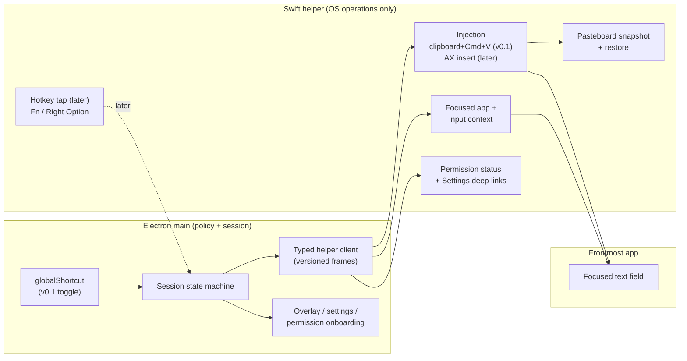

# Text Injection, Global Hotkeys, and Focus Context for JustSpeak v0.1

- Status: Accepted design baseline for v0.1. The hotkey and injection defaults are
  frozen; the Fn/Right Option event tap and direct Accessibility insertion are
  explicitly deferred upgrades.
- Date: 2026-10-26
- Decision owner: FD2008
- Depends on: [ADR-0001: Core boundary](ADR-0001-core-boundary.md),
  [ADR-0002: Technology stack](ADR-0002-tech-stack.md),
  [ARCHITECTURE.md](ARCHITECTURE.md), [AUDIO-PIPELINE.md](AUDIO-PIPELINE.md)
- Scope: macOS v0.1 global hotkey, text injection, focused-application/input context,
  permission model, wake/sleep recovery, failure handling, and the native-boundary
  shape for these features. No code, packages, or native tests are included in this
  card.
- Evidence tags: **E2** = primary code/config/artifact inspected directly for this
  document (repository file, source file, package manifest, license text).
  **E3** = web/third-party documentation or third-party reverse engineering. E3 claims
  must be re-checked before they become implementation facts. Access date: 2026-10-26.

## Context and Constraints

JustSpeak v0.1 is a macOS-first desktop dictation app. The user presses a hotkey,
speaks, and clean text appears at the cursor of the focused application. The stack is
Electron 45 + TypeScript + React 19 + electron-vite 6 + a small Swift helper
(ADR-0002). `src/core` owns the audio, VAD, chunking, ASR adapters, and post-processing
and must stay free of Electron, React, DOM, and OS imports (ADR-0001).

This document covers the last mile: how dictation starts, how the finished text reaches
the target application, and what the app may know about that target. The following
decisions are frozen for this card:

- The Swift helper is the native boundary. It owns Accessibility operations, focused
  context, and injection; it contains no product policy and no network client.
- Electron `globalShortcut` is the v0.1 hotkey default.
- Clipboard + `Cmd+V` is the v0.1 injection default.
- A `CGEventTap` for Fn / Right Option and direct `AXUIElement` insertion are later
  upgrades, not v0.1 requirements.
- macOS Accessibility permission is acceptable. v0.1 has no Mac App Store sandbox
  constraint and no paid-service dependency.
- v0.1 does not read screen content or the text around the cursor by default
  (ARCHITECTURE.md, data classification).

Requirements that drive the options:

| ID | Requirement | Why it matters |
|---|---|---|
| R1 | Start and stop dictation while another app is frontmost | This is the product's primary interaction |
| R2 | Work in the apps people actually dictate into: native Cocoa apps, browsers, Electron apps, terminals, IDEs, chat apps | A 90% solution that fails in the user's main app is a broken product |
| R3 | Never leak or destroy user clipboard content | The clipboard is shared, user-owned state |
| R4 | Never type into password/secure fields and never read their contents | Security and trust boundary |
| R5 | Recover from sleep/wake, screen lock, permission changes, and helper restarts | Laptop lifecycles invalidate global shortcuts and event taps |
| R6 | Explain and request only the permissions actually needed | Accessibility and Input Monitoring are high-friction prompts |
| R7 | Keep the Windows-later path a helper swap, not a rewrite | ADR-0002 constraint |
| R8 | Preserve the local-first/privacy differentiation | Context capture is the largest privacy risk in this feature set |

### Deviation from ARCHITECTURE.md

ARCHITECTURE.md "Stage detail" step 6 describes the helper as trying an Accessibility
insert first and falling back to clipboard + paste. This card freezes the inverse for
v0.1: **clipboard + `Cmd+V` first, Accessibility insertion later**. The reason is
compatibility: one paste path works almost everywhere, while direct Accessibility
insertion is inconsistent across web views, terminals, and self-drawn UIs. The
Accessibility-first order remains the long-term target for apps where it is proven.

This is a deliberate, frozen product decision, not an oversight. It requires a
follow-up docs card to amend ARCHITECTURE.md step 6 and close/open the injection
compatibility question in that document. Until then, treat this document as the
injection-specific override.

## Options

### Global hotkey options

#### Option H1 — Electron `globalShortcut` in the main process (v0.1 default)

**Shape.** Main registers a configurable accelerator such as
`Command+Shift+Space` with `globalShortcut.register(accelerator, callback)`. The
callback starts or stops a dictation session. No native code is involved in the hotkey
path.

**Fn / Right Option support.** None. Electron's accelerator grammar has no standalone
Fn/Globe key, no modifier-only trigger, and no way to distinguish the left and right
versions of a modifier. It reports a key press, not a release, so hold-to-talk is not
expressible.

**Conflicts.** `register()` returns a boolean. When another app already owns the
shortcut, registration fails silently at the OS level (Electron documents this as
intended behavior), so the app must check the return value and surface a conflict
instead of pretending the hotkey works. There is no reliable system API to enumerate
who owns a conflicting shortcut; the practical UX is "that shortcut is unavailable,
choose another" plus a test field.

**Keyboard layouts.** Accelerators are expressed as key names, not raw keycodes, so
they follow the active layout. That is usually desirable, but it must be tested on
Dvorak, a Chinese IME, and JIS hardware. A layout change while the app is running can
change which physical key triggers the shortcut; re-registration on layout change is an
open question.

**Accessibility permission.** Normal combinations do not require Accessibility.
Electron documents that the media-key accelerators require the app to be a trusted
Accessibility client on macOS; JustSpeak will not use media keys as the primary
binding. This matters for onboarding: the hotkey can work before injection permission
is granted, but injection still needs Accessibility (see I1).

**Wake/sleep and lock.** macOS does not guarantee that a global shortcut survives
sleep, wake, fast user switching, or a display-lock cycle. Main must re-register on
`powerMonitor` resume and on app activation, verify with `isRegistered()`, and expose a
visible "hotkey inactive" state. A failed re-registration is a first-class error, not a
silent degradation.

**Latency.** One OS event to the main process; the ARCHITECTURE target is ≤ 20 ms from
hotkey to main. This path adds no helper hop.

**Evidence.** E3: Electron `globalShortcut` documentation (boolean return, silent
failure when taken, media keys requiring trusted Accessibility). E3: Electron
accelerator documentation (modifier/key grammar). E2: ARCHITECTURE.md assigns the
simple toggle hotkey to Electron `globalShortcut`. The absence of Fn/modifier-only
support is an inference from the documented accelerator grammar and must be confirmed
with a spike; it is also consistent with justspeaktoit using an event tap for Fn while
using Carbon hotkeys for ordinary shortcuts.

#### Option H2 — Swift `CGEventTap` in the helper (later upgrade)

**Shape.** The helper creates an event tap at the HID layer
(`CGEventTapCreate(kCGHIDEventTap, kCGHeadInsertEventTap, kCGEventTapOptionDefault,
...)`), receives key-down, key-up, and flags-changed events, matches them against a
configured trigger, and reports press/release to main. An active tap can swallow the
trigger so the frontmost app does not also receive it.

**Fn / Right Option support.** This is the only option that supports both. Fn arrives
as a flags-changed event (`kCGEventFlagMaskSecondaryFn`); Right Option is the
device-dependent right-Option modifier (`kVK_RightOption` = 61 and the right-modifier
flag bit). Both are modifier-only triggers, so the helper needs a deliberate state
machine: arm on press, fire after a short threshold (for example 250–400 ms) or on
release with a short-tap rule, cancel if another key or click arrives, and never swallow
the modifier until the trigger is committed. Otherwise Right Option stops composing
special characters and Fn starts the emoji picker.

**Conflicts.** System behavior can consume Fn before the app sees it: modern macOS can
map the Globe/Fn key to emoji, dictation, input-source switching, or "do nothing" in
System Settings. Typeless ships Fn as a default trigger, and justspeaktoit documents
that Fn uses an event tap/global monitor and requires Input Monitoring, which is
evidence that the path works, not evidence that it is conflict-free. Other event taps
can also see or swallow events first; there is no exclusivity guarantee. The product
must include a "press your shortcut now" diagnostic and a recovery action.

**Keyboard layouts.** Fn and Right Option are physical modifiers and are independent of
the letter layout. Shortcut matching must use keycodes and modifier flags, not
characters. The Fn/Globe system mapping is a separate conflict, not a layout issue.

**Accessibility permission.** An active tap requires Accessibility trust; a listen-only
tap requires Input Monitoring (`CGPreflightListenEventAccess`). justspeaktoit's runbook
states that Fn "requires Input Monitoring". JustSpeak should request both only when the
user enables a Fn/Right Option binding, and explain that the default
`globalShortcut` path needs neither.

**Wake/sleep and lock.** The system disables taps when the callback is too slow
(`kCGEventTapDisabledByTimeout`) or on user input (`kCGEventTapDisabledByUserInput`);
it can also invalidate them across wake, unlock, and app activation. The helper must
re-enable the tap, and re-create it when re-enabling fails. justspeaktoit documents
exactly this recovery behavior, including reconnecting after idle activation, wake, and
session unlock without disturbing an in-flight recording. That runbook is the closest
production evidence for this design.

**Latency.** Sub-millisecond event delivery at the HID layer plus the helper IPC hop;
lower than a main-process-only path is not the point. The reason to add this option is
capability (Fn/Right Option, press/release), not speed.

**Evidence.** E3: Typeless notes — `CGEventTapCreate` at the HID layer, head-insert,
active tap; event mask includes key down/up, flags changed, and other mouse buttons;
keyboard helper runs in a separate child process; a watcher re-enables the tap after the
system disables it. E3: justspeaktoit `Docs/mac-background-hotkeys-and-output.md` — Fn
uses an event tap/global monitor, requires Input Monitoring, is re-enabled after macOS
disables it, and reconnects after wake/unlock. E3: Apple `CGEvent` and TN2150
documentation for event taps and secure input.

#### Option H3 — Carbon `RegisterEventHotKey` in the helper

**Shape.** The helper registers ordinary shortcuts with Carbon
`RegisterEventHotKey`, installs a keyboard event handler, and returns a real `OSStatus`
on conflict. This is what justspeaktoit uses for its custom shortcuts; Electron's
`globalShortcut` is an equivalent capability at a higher level.

**Fn / Right Option support.** None, for the same structural reason as H1: a Carbon
hotkey is a keycode plus modifier mask, not a modifier-only trigger.

**Assessment.** This is the right **comparator and fallback** if Electron's registration
behavior proves unreliable, not the v0.1 default. Using it would move ordinary hotkey
registration into the helper and add IPC before a session can start, for no v0.1
capability gain. Its conflict reporting is better than Electron's boolean, which is
worth revisiting if onboarding conflict rates are high.

**Evidence.** E2: justspeaktoit `Sources/SpeakApp/Services/ShortcutManager.swift` —
Carbon registration, `OSStatus` conflict collection, global-binding filtering.
E3: Apple Carbon Event Manager documentation.

#### Option H4 — `NSEvent` global monitor

**Shape.** `NSEvent.addGlobalMonitorForEvents` observes key events in other apps.

**Assessment.** Rejected. It requires the same trust as an event tap, cannot consume
the event (the frontmost app still sees it), and does not give a reliable press/release
session model for a dictation trigger. It is useful for diagnostics, not for the
primary hotkey.

### Text injection options

#### Option I1 — Clipboard + synthesized `Cmd+V` (v0.1 default)

**Shape.** The helper performs a bounded sequence:

1. Check whether secure event input is active and whether the focused element is a
   secure text field. If either is true, do not synthesize keys.
2. Snapshot every item and type currently on `NSPasteboard.general`, resolving promised
   data immediately because the source app may disappear before restore.
3. Write the transcript as plain text with a transient marker (the
   `org.nspasteboard.TransientType` convention) so well-behaved clipboard managers skip
   it.
4. Resolve the virtual keycode that produces `v` in the **current** keyboard layout
   (`TISCopyCurrentKeyboardInputSource` + `UCKeyTranslate`), not a hard-coded ANSI
   keycode.
5. Post `Cmd` down, `V` down/up, `Cmd` up through `CGEventPost`.
6. Wait for the target app to consume the paste using a bounded delay and, where
   available, an Accessibility value-change observation. There is no OS callback for
   "the target pasted".
7. Restore the snapshot only if the pasteboard `changeCount` shows that no one else
   wrote to it in the meantime. If it changed, do not clobber the user's new content.
8. On any failure, leave the transcript on the clipboard and show a "copied, paste
   manually" notice. Do not retry automatically, because a retry can paste twice.

**Reliability.** Highest of the four options across native apps, browsers, Electron
apps, terminals, and IDEs. Typeless's shipped insertion path is exactly this and has no
"set the field value directly" branch; justspeaktoit's direct build also ships
clipboard paste, and its Mac App Store build is clipboard-only because the sandbox
forbids cross-process event injection. This is the strongest available evidence that
the path is production-viable.

**Clipboard side effects.** The transcript temporarily replaces the user's clipboard.
Risks: a clipboard manager captures it despite the transient marker (best-effort
convention, not a guarantee); Universal Clipboard may sync it to the user's other
devices; restoring a very large snapshot (images, files, multiple items) costs memory
and time; some apps read the pasteboard lazily, so an early restore can produce stale
or empty paste; and a user copy during the window must win over the restore. These are
manageable with snapshot/restore, `changeCount` checks, a bounded snapshot size, and a
short restore delay, but they cannot be eliminated.

**Secure input and password fields.** Do not attempt. Secure event input stops keyboard
events from reaching event taps and blocks synthesized keystrokes; secure text fields
also refuse Accessibility writes and usually refuse paste. Detect via
`IsSecureEventInputEnabled()` and the focused element's `AXSubrole ==
kAXSecureTextFieldSubrole`, then fall back to clipboard-only with a visible notice. Note
that `IsSecureEventInputEnabled()` is system-wide and can be true because of an
unrelated password manager; treat it as a conservative gate, not proof about the
focused field.

**Terminals and IDEs.** This is the main reason to choose clipboard paste first.
Terminals (Terminal, iTerm2, WezTerm), Electron editors (VS Code, Cursor), and
self-drawn UIs (WeChat, Excel, Google Docs) are exactly where direct Accessibility
insertion is least reliable. Paste mostly works, but terminal bracketed-paste handling,
shell paste-confirmation prompts, and Vim-mode editors can still change the result; the
compatibility matrix must record those cases rather than assuming success.

**Latency.** One paste event plus the restore delay. The "text at cursor" target is
≤ 100 ms after final text; clipboard restoration may take another 100–250 ms and must
not block the session-done state.

**Evidence.** E3: Typeless notes — snapshot, transient write, layout-aware `Cmd+V`,
restore; the only insertion path is paste. E2: justspeaktoit `PasteboardSnapshot.swift`
— byte-for-byte snapshot of every item/type, promised data resolved up front, exact
restore. E2: justspeaktoit runbook — direct build allows paste, Mac App Store build is
clipboard-only under sandbox. E3: Apple `NSPasteboard` documentation (`changeCount`,
promised data). E3: TN2150 for secure event input. E3: Electron `clipboard`
documentation for the renderer/main surfaces (the helper uses `NSPasteboard` directly).

#### Option I2 — Direct `AXUIElement` insertion (later upgrade)

**Shape.** The helper reads the focused element from the system-wide Accessibility
element, then sets `kAXSelectedTextAttribute` to the transcript. If the selected-text
write fails, a fallback may set `kAXValueAttribute` to the complete new field value.
justspeaktoit's `AccessibilityInsertionWriter` does exactly this: set selected text
first, then replace the whole value on failure, revalidating the destination before
each write.

**Reliability.** High in native Cocoa text controls (TextEdit, Notes, Mail, native
settings/search fields). Low and inconsistent elsewhere: web content and Electron apps
often expose no writable selected-text attribute unless the app has built an
Accessibility tree (`AXEnhancedUserInterface` is the known Chromium/Electron trigger,
with a short wait after setting it); terminals expose the whole scrollback as a text
area; self-drawn UIs (WeChat, Excel, WPS, Zed) are unreliable. Typeless maintains
explicit app and URL blacklists/whitelists for exactly this reason.

**The whole-field fallback is destructive.** Setting `kAXValueAttribute` replaces the
entire field. If the transcript is meant to be inserted at the cursor, this can delete
existing content. JustSpeak must not use the whole-field fallback unless the app is on
a tested whitelist and the field is empty, or the user explicitly chose "replace all".
This is a hard rule, not a performance trade-off.

**Clipboard side effects.** None. This is the option's main advantage.

**Secure input and password fields.** Secure fields do not expose a writable value or
selected text; Accessibility calls fail. Do not read or write them.

**Latency.** Usually a few milliseconds, but Accessibility calls can hang in a busy or
misbehaving app. Every call needs `AXUIElementSetMessagingTimeout` (for example 50–150
ms) and must run off the UI-critical path; "fast" is only true with timeouts.

**When to use.** Phase 3, behind an app whitelist, with paste as the default and AX as
an opt-in fast path. A failed AX write falls back to paste, not to a destructive value
replacement.

**Evidence.** E2: justspeaktoit `AccessibilityInsertionWriter.swift` (selected-text
write, whole-value fallback, destination revalidation). E2: justspeaktoit runbook
(direct build targets the captured field; redirected destination changes fall back to
clipboard). E3: Typeless `libContextHelper` / `libInputHelper` evidence — AX APIs,
`AXEnhancedUserInterface` with a 30 ms wait, text-marker reads, app blacklists. E3:
Apple `AXUIElement` documentation.

#### Option I3 — Synthesized Unicode keystrokes (fallback only)

**Shape.** Create keyboard events and attach a Unicode string
(`CGEventKeyboardSetUnicodeString`), then post them to the target.

**Reliability.** It reaches most apps that accept keyboard input, and Unicode
injection is layout-independent. But it is slow for long text, paced per character or
chunk, and can drop characters under load. It triggers autocorrect/autocomplete, IME
composition, and per-character undo in many apps. Terminals may interpret control
characters. Secure input blocks it. It is also impossible to make atomic: a partial
insertion leaves corrupted text, and retrying duplicates text.

**Assessment.** Rejected as a default. Keep it only as a last-resort fallback for short
text in an app that accepts typing but rejects paste, behind an explicit flag and with
a strict length cap.

**Evidence.** E3: Typeless imports `CGEventCreateKeyboardEvent` /
`CGEventSetFlags` / `CGEventPost` for the paste keystroke, not for typing the
transcript; E3: Apple `CGEvent` documentation.

#### Option I4 — AppleScript / `System Events` keystroke

**Shape.** Run `osascript` to tell System Events to keystroke the text or press
`Cmd+V`, or use an app-specific `set value` script.

**Assessment.** Rejected as unreliable. It spawns an extra process (usually hundreds of
milliseconds of overhead), still requires Accessibility, is brittle across app versions
and localizations, has no reliable error/ack model, and interacts badly with IMEs and
keyboard layouts. App-specific `set value` scripts do not generalize. A dictation
product cannot put its last mile behind a scripting bridge whose failure modes it
cannot observe.

**Evidence.** E3: Apple `osascript` / System Events documentation; architecture
constraint that the helper must have no shell interpolation. No shipping dictation
product in the sampled set uses AppleScript as its primary injection path.

#### Option I5 — Rich text insertion (future extension)

Typeless's "replace" mode writes both HTML and plain text to the pasteboard so rich
editors receive formatting. This is not needed for v0.1 dictation, but it fits the same
clipboard sequence and should not require a new injection architecture. Record it as a
future extension, not a separate option.

### Focus context options

#### Option F1 — App-level context only (v0.1 default)

**Shape.** The helper reports the frontmost application's localized name, bundle
identifier, process id, and activation state via `NSWorkspace`. No window title, no
element inspection, no selection, no surrounding text.

**What it enables.** App-specific behavior (for example, choosing the clipboard path in
a terminal), per-app settings, safe logging, and the privacy promise already made in
ARCHITECTURE.md. It does not require Accessibility for the app identity itself.

**What it cannot do.** It cannot tell whether a text field is focused, whether it is
editable or secure, or what is selected. For v0.1, the helper may additionally inspect
the focused element **only** for the safety flags needed by injection (secure field and
editability), under the Accessibility permission the injection path already needs. That
is a narrow, documented exception, not general context capture.

**Window title caveat.** `CGWindowListCopyWindowInfo` window names are unavailable for
other apps without Screen Recording on modern macOS. Reading the focused window's
`AXTitle` requires Accessibility. v0.1 must not request Screen Recording, so window
titles are not part of the v0.1 context.

**Evidence.** E2: ARCHITECTURE.md data classification ("v0.1 captures only app
name/bundle id and focus state; no surrounding text, no screen text, no keystroke
logging"). E3: Apple `NSWorkspace` documentation.

#### Option F2 — Accessibility focus context (later, opt-in)

**Shape.** From `AXUIElementCreateSystemWide()`, read
`kAXFocusedApplicationAttribute`, then `kAXFocusedUIElementAttribute`. From the focused
element read role/subrole, title/description, editable state, selected text
(`kAXSelectedTextAttribute`), and the selected range. Read text before/after the cursor
by combining `kAXSelectedTextRangeAttribute` with `kAXValueAttribute` or the
parameterized string-for-range API. For WebKit/Chromium content, use text-marker
ranges (`AXTextMarkerRangeCreate` and related parameterized attributes), as Typeless
does.

**Reliability.** Best-effort. Native Cocoa apps expose predictable attributes; browsers
and Electron apps often need `AXEnhancedUserInterface` set and a short wait; terminals
expose the entire scrollback as one text area; some apps return errors or time out.
Every call needs a messaging timeout, and the capture must have a total budget.

**Privacy cost.** This is the highest-risk data in the product. The Typeless notes show
that a terminal dictation can capture 5,000 characters before the cursor and 10,003
characters of visible text in about 109 ms, including secrets printed to the terminal;
chat apps can expose other people's messages. JustSpeak must not copy that behavior.
The v0.1 default remains F1. F2, if enabled later, needs explicit opt-in, per-app
blacklists, a preview, hard caps, and no logging or telemetry of content.

**Suggested caps if enabled later.** 300 characters before + 300 after the cursor
(configurable 0–1,000), 500 characters of selected text, 2,000 characters total, 100 ms
per attribute, 300 ms total; no visible text, no screen content, no URLs, no keystroke
history. These are deliberately far below Typeless's limits.

**Evidence.** E3: Typeless notes `06-context-capture-and-privacy.md` — capture timing,
10,000-character visible-text cap, ±1,000 surrounding cap, 500 ms timeouts, 1 s polling,
blacklist/whitelist contents, and the terminal/chat leakage observations. E2:
justspeaktoit `AccessibilityInsertionWriter.swift` shows the narrow AX write surface;
the runbook shows the captured-target/focus-change policy. E3: Apple `AXUIElement`
documentation.

#### Option F3 — Clipboard probe for selected text

**Shape.** Snapshot the pasteboard, synthesize `Cmd+C`, read the pasteboard, restore it.
Typeless uses this when Accessibility cannot read the selection.

**Assessment.** Not a v0.1 default and never automatic. It has the same clipboard side
effects as I1, fails in secure fields, changes the user's selection, and can hang if the
target app does not respond. If it is ever used, it must be an explicit user action
("use selected text") with a short timeout and a clear notice.

**Evidence.** E3: Typeless notes — `getSelectedTextBySimulateCopyAsync` saves, copies,
reads, and restores.

#### Option F4 — Screen capture / OCR / visible-text scraping

**Assessment.** Rejected for v0.1 and for the foreseeable roadmap. It requires Screen
Recording permission, contradicts the privacy differentiation, captures unrelated
content, and is far more invasive than the product needs. This option is recorded only
to make the boundary explicit.

### Native boundary options

#### Option N1 — Out-of-process Swift helper over versioned IPC (chosen)

**Shape.** Main launches a small, long-lived Swift helper over a versioned,
length-prefixed frame protocol (stdio or a Unix domain socket). The helper exposes a
narrow command set: handshake/capabilities, permission status, focused app, input
context, `injectText` (with a mode), and later hotkey/event-tap control. Main owns
policy, timeouts, and retries; the helper owns OS calls.

**Pros.** A native crash or hang does not take down Electron; the helper can be killed
and restarted; the contract is testable with a fake helper; there is no Node ABI
coupling; the same contract shape can be implemented by a Windows helper later; AX and
injection code stays out of the TypeScript main process; permissions are attributed to
the signed app bundle when the helper is correctly bundled and code-signed (verify with
TCC).

**Cons.** An extra process and lifecycle; an IPC contract to version and test; a
permission-attribution question to verify for the helper process; slightly more latency
than an in-process call (negligible for short text and context payloads).

**Evidence.** E2: ADR-0002 and ARCHITECTURE.md choose exactly this shape and define the
command set. E2: justspeaktoit is a single native process, not a direct comparator, but
its runbook shows the operational behaviors the helper must implement. E3: Typeless
loads its keyboard helper in a separate child process even though it uses dylibs for
other functions, which supports isolating the risky event-tap surface.

#### Option N2 — Swift dylib via `koffi` in-process (spike only)

**Shape.** Build Swift dynamic libraries with a C ABI and load them from Node/Electron
with `koffi`/FFI. Typeless ships four such dylibs (context, input, keyboard, utility)
and calls them from its Electron main process.

**Pros.** Lowest call latency; no IPC framing; direct callbacks; proven by a shipping
competitor.

**Cons.** A segfault or Swift runtime trap kills the Electron main process; synchronous
AX or pasteboard calls can block the main thread; callbacks cross the JS/native
boundary and need careful thread/run-loop handling; ABI and macOS SDK coupling; no
versioned contract; permission attribution and crash reporting are murkier; the
keyboard helper still runs in a separate process, so the "simplest" shape is already
partly abandoned for the riskiest part.

**Assessment.** Acceptable for a short feasibility spike (for example, to validate AX
attribute behavior on a matrix of apps). Not the architecture.

**Evidence.** E3: Typeless `07-native-helpers.md` — four Swift dylibs loaded by
`koffi`, C signatures, keyboard helper in a separate child process. E3: `koffi`
documentation.

#### Option N3 — N-API native addon

**Shape.** Compile a Node addon (C++/Objective-C++ or a Swift bridge) and load it with
`require`.

**Pros.** In-process, no separate process, direct Node integration.

**Cons.** Must be rebuilt for Electron's Node ABI on every Electron major; crash takes
down the app; build toolchain and signing complexity; TCC attribution is less clear;
the Windows path needs a separate addon; it has no advantage over N1 for this small
command surface.

**Assessment.** Reject. ADR-0002 already rejected a native addon via FFI for crash and
ABI reasons; the same reasoning applies.

**Evidence.** E3: Node N-API and Electron native-module documentation; ADR-0002
architecture options.

#### Option N4 — Pure Electron APIs, no native helper

**Shape.** `globalShortcut` for the hotkey, Electron `clipboard` for the text, and a
synthesized paste via a third-party key-simulation module (or no paste at all).

**Pros.** No native code, fastest to build, no Accessibility permission needed just to
register an ordinary hotkey.

**Cons.** Electron does not expose the frontmost app's bundle id, the focused element,
secure-field state, or editability. It cannot implement the safety checks R3/R4
properly. Third-party key simulators are CGEvent wrappers with their own maintenance
and permission problems, and some are unmaintained. It also leaves no place for the
future AX/event-tap work.

**Assessment.** Reject as the architecture, while keeping `globalShortcut` as the v0.1
hotkey mechanism inside N1. The helper is still required for safe injection and context.

**Evidence.** E3: Electron API documentation (no frontmost-app/focused-element API).
E2: ARCHITECTURE.md assigns these capabilities to the Swift helper.

### Candidate architecture

The boundary rules are the load-bearing part:

- **Electron main:** hotkey registration (`globalShortcut`), session policy, overlay
  state, permission onboarding, helper lifecycle, validation, and timeouts. It never
  calls AX or posts CGEvents directly.
- **Swift helper:** `getFocusedApp`, `getInputContext` (v0.1: app identity plus the
  safety flags), `injectText` with an explicit mode, `getPermissionStatus`,
  `openPermissionSettings`, and later `startHotkeyTap` / `stopHotkeyTap`. It contains no
  retry policy, no app blacklist policy, and no network.
- **Injection:** v0.1 always uses `clipboardPaste`. `axInsert` is a later mode, gated by
  a whitelist and by capability flags in the handshake.
- **Hotkey:** v0.1 always uses Electron `globalShortcut`. The helper event tap is a
  later capability, reported through the handshake so main can enable the Fn/Right
  Option UI only when the helper supports it.
- **Context:** v0.1 captures app name/bundle id plus focus/secure/editable flags.
  Surrounding text and selection are later, opt-in capabilities reported as
  unavailable by default.

**Phased delivery:**

| Phase | Hotkey | Injection | Context | Exit gate |
|---|---|---|---|---|
| 0 — Spike | `globalShortcut` prototype | Clipboard paste via a minimal helper | App identity + secure/editability flags | 12-app compatibility matrix; wake/sleep and permission recovery proven |
| 1 — v0.1 | Configurable `globalShortcut` toggle | Clipboard + `Cmd+V`, snapshot/restore, secure-field skip | App-level only | Paste success and clipboard-restore gates met; conflict onboarding |
| 2 — Hotkey upgrade | Helper `CGEventTap` for Fn / Right Option and push-to-talk; `globalShortcut` fallback | Unchanged | Unchanged | Tap recovery across wake/unlock; modifier-tap false-positive rate characterized |
| 3 — Injection upgrade | Unchanged | AX insert for whitelisted native apps; paste remains default | Opt-in AX context with caps | Per-app AX matrix; no destructive whole-field writes |
| 4 — Windows | Windows helper implements the same contract | Clipboard + `Ctrl+V`; `SendInput`/UIA later | UIA equivalents | Contract tests against the same fake helper |

## Comparison

Scores are 1 (worst) to 5 (best) and are the author's judgment informed by the evidence,
not measured benchmarks. Weights reflect the frozen product priorities: shipping
velocity, compatibility across the apps people dictate into, safety, and the
Windows-later path.

### Hotkey comparison

| Criterion | Weight | H1: Electron `globalShortcut` | H2: Swift `CGEventTap` | H3: Carbon in helper | H4: `NSEvent` monitor |
|---|---:|---:|---:|---:|---:|
| v0.1 delivery velocity | 0.25 | 5 | 2 | 3 | 3 |
| Fn / Right Option / hold support | 0.20 | 1 | 5 | 1 | 3 |
| Conflict handling and diagnostics | 0.20 | 4 | 3 | 4 | 2 |
| Permission and onboarding cost | 0.10 | 5 | 2 | 4 | 2 |
| Wake/sleep and lock recovery | 0.10 | 3 | 3 | 3 | 2 |
| Keyboard-layout robustness | 0.10 | 4 | 5 | 4 | 4 |
| Windows-later reuse | 0.05 | 5 | 1 | 1 | 1 |
| **Weighted total** | **1.00** | **3.70** | **3.15** | **2.90** | **2.60** |

Reading the matrix:

- H1 wins for v0.1 because it ships a working, permission-light toggle immediately. It
  is the worst option at Fn/Right Option, which is exactly why the card defers those to
  a later upgrade.
- H2 is the only option that satisfies the modifier-only requirement. It loses now on
  velocity and permission cost, and it should be added in Phase 2 when the product has
  a reason to support Fn/Right Option.
- H3 is a viable fallback if Electron's registration proves unreliable; it has better
  conflict reporting but no Fn support.
- H4 is not competitive for a primary trigger.

### Text injection comparison

| Criterion | Weight | I1: Clipboard + `Cmd+V` | I2: AX direct insert | I3: Unicode keystrokes | I4: AppleScript |
|---|---:|---:|---:|---:|---:|
| Cross-app reliability | 0.35 | 5 | 3 | 4 | 2 |
| Clipboard side effects | 0.10 | 2 | 5 | 5 | 4 |
| Terminals / IDEs / Electron apps | 0.20 | 5 | 2 | 4 | 3 |
| Secure-input safety | 0.10 | 4 | 2 | 1 | 1 |
| Latency and atomicity | 0.10 | 4 | 5 | 2 | 1 |
| Complexity and testability | 0.15 | 4 | 3 | 3 | 2 |
| **Weighted total** | **1.00** | **4.35** | **3.10** | **3.45** | **2.20** |

Reading the matrix:

- I1 wins because it works where users actually type. Its weakness is the clipboard,
  which is a known, bounded side effect with a snapshot/restore protocol.
- I2 wins on side effects and latency but loses on compatibility. It is a **targeted
  fast path for whitelisted native apps**, not a replacement for paste. Its destructive
  whole-field fallback must never be a default.
- I3 scores higher than I2 overall only because of its broad reach; its secure-input,
  atomicity, IME, and undo failures make it unsuitable as a default.
- I4 is rejected. The matrix agrees with the qualitative analysis.

### Focus context comparison

| Criterion | Weight | F1: App-level | F2: AX context | F3: Clipboard probe | F4: Screen/OCR |
|---|---:|---:|---:|---:|---:|
| Privacy fit | 0.30 | 5 | 2 | 3 | 1 |
| Field coverage | 0.25 | 2 | 5 | 3 | 5 |
| Reliability | 0.20 | 5 | 3 | 2 | 4 |
| Latency | 0.10 | 5 | 4 | 2 | 4 |
| Permission cost | 0.15 | 5 | 2 | 2 | 1 |
| **Weighted total** | **1.00** | **4.25** | **3.15** | **2.55** | **2.90** |

Reading the matrix:

- F1 is the v0.1 default and matches the accepted privacy promise.
- F2 is the only option that provides selection and surrounding text, and it is the
  planned opt-in upgrade. Its score is low now because the privacy and permission costs
  are real, not because the capability is unwanted.
- F3 is a fallback for a single explicit action, not a context strategy.
- F4 is rejected; a high coverage score does not justify the privacy and permission
  cost.

### Native boundary comparison

| Criterion | Weight | N1: Helper process | N2: `koffi` dylib | N3: N-API addon | N4: Electron only |
|---|---:|---:|---:|---:|---:|
| Capability (AX, context, event tap, safe paste) | 0.25 | 5 | 5 | 5 | 2 |
| Crash and ABI safety | 0.20 | 5 | 2 | 2 | 5 |
| Latency | 0.10 | 3 | 5 | 5 | 5 |
| Permission attribution and isolation | 0.10 | 4 | 3 | 2 | 2 |
| Maintainability and testability | 0.15 | 4 | 2 | 1 | 5 |
| Windows-later reuse | 0.10 | 5 | 2 | 2 | 4 |
| Delivery velocity | 0.10 | 5 | 5 | 4 | 4 |
| **Weighted total** | **1.00** | **4.55** | **3.15** | **2.90** | **3.75** |

Reading the matrix:

- N1 wins because the product needs native capability without letting a native crash or
  an ABI change take down the app, and because the contract survives the Windows port.
- N4 is simpler and would score well on velocity, but it cannot implement the safety
  checks that R3/R4 require. It is a component (the hotkey), not the boundary.
- N2 and N3 are useful for spikes and rejected for the shipped architecture.

## Recommendation

Adopt the phased candidate architecture above. Concretely:

1. **Hotkey (v0.1).** Register a configurable toggle with Electron
   `globalShortcut` in the main process. A tentative default is
   `Command+Shift+Space`; validate it against a conflict sweep before shipping, and
   treat the default as an open question rather than a brand decision. Check the
   boolean return of `register()`, surface a conflict in onboarding, and re-register on
   wake, unlock, and app activation. Do not use media keys. Do not claim Fn or
   Right Option support in v0.1.

2. **Hotkey (later).** Add a helper-owned `CGEventTap` for Fn / Right Option and
   push-to-talk. Use a modifier-tap threshold and cancel on any other key or click.
   Keep the `globalShortcut` binding as the fallback when the tap cannot be created or
   is disabled. Re-enable the tap after timeout/user-input disable, wake, and unlock;
   expose a "Reconnect hotkey" diagnostic. Fn is only offered after a conflict check
   against the user's Globe/Fn system setting; Right Option is offered with a warning
   that it is a modifier.

3. **Injection (v0.1).** Ship clipboard + `Cmd+V` only, implemented in the Swift helper:
   secure-input and secure-field pre-check, full pasteboard snapshot, transient write,
   layout-aware keycode, bounded wait, `changeCount`-guarded restore, and a
   copy-only fallback notice. Never synthesize keys into a secure field. Never paste a
   second copy automatically.

4. **Injection (later).** Add `axInsert` as an opt-in mode for whitelisted native apps.
   Use `kAXSelectedTextAttribute`; do not use the whole-field `kAXValueAttribute`
   fallback unless the field is empty or the user explicitly chose replace-all. Fall
   back to paste on any AX failure. Build the compatibility matrix before enabling it
   by default for an app.

5. **Context (v0.1).** Capture only app name, bundle id, pid, focus state, and the
   narrow secure/editable flags needed for safe injection. Do not capture window
   titles, selection, surrounding text, visible text, URLs, or keystrokes. Do not
   request Screen Recording.

6. **Context (later).** Offer an explicit opt-in "help JustSpeak understand the field"
   mode with per-app rules, a preview of what would be captured, hard caps (300/300
   characters around the cursor, 2,000 total, 300 ms budget), no content in logs or
   telemetry, and terminal/chat/password-manager apps blocked by default. Context is a
   quality feature, not a requirement for v0.1; if it cannot be made understandable in
   the UI, it should not ship.

7. **Native boundary.** Use the out-of-process Swift helper from ADR-0002. Keep the
   command surface small and versioned. Use `koffi` only for a disposable spike, never
   in the shipped app. Reject N-API. Verify TCC attribution for the bundled helper
   before release: the Accessibility grant should attach to the signed app, not to an
   opaque child process.

8. **Permissions.** Request Accessibility when the user enables dictation output, not
   at first launch. Explain that it is used to paste into the frontmost app and to
   avoid password fields; deep-link to System Settings; show a live status. Request
   Input Monitoring only if the user enables a Fn/Right Option binding. Never request
   Screen Recording. Re-check permission state after wake and before each session, and
   degrade to clipboard-only if Accessibility is revoked.

9. **Design gates before implementation locks in.** These are targets to validate, not
   measured results: (a) paste success in at least 12 representative apps, including
   Terminal, iTerm2, VS Code/Cursor, Slack, Chrome, an Electron app, WeChat, Excel, and
   a native Cocoa app; (b) clipboard restore succeeds whenever `changeCount` shows no
   external write; (c) secure-field detection produces zero synthetic keystrokes in a
   password-field test set; (d) injection acknowledged within 100 ms p95, with restore
   not blocking the done state; (e) hotkey conflict and wake/sleep recovery observed in
   at least 10 cycles; (f) no transcript, selection, or surrounding text appears in
   logs, telemetry, or crash reports.

10. **Documentation follow-up.** Amend ARCHITECTURE.md step 6 (injection order), its
    Open Question 5 (injection compatibility), and the permission section to record the
    clipboard-first default and the narrow AX safety checks.

## Failure Modes

| Failure | Detection | Behavior | User-visible result |
|---|---|---|---|
| No focused text field | `kAXFocusedUIElementAttribute` returns no value / error; editability is false | Do not attempt AX; for paste, only paste if the app is known to route paste into a field, otherwise stop | Transcript stays on the clipboard with a "copied" notice; no text is typed into an unrelated target |
| Secure event input active | `IsSecureEventInputEnabled()` true | Never synthesize keys; never read the field | Clipboard-only notice; text is not lost |
| Secure text field focused | `AXSubrole == kAXSecureTextFieldSubrole`; AX value/selection calls fail | Skip paste and AX write; do not log field contents | Clipboard-only notice; no password-field interaction |
| App on the compatibility blacklist (self-drawn UI, terminal, chat) | Local per-app/bundle-id rule | Prefer clipboard paste; disable AX insertion and context capture for that app | Normal dictation, with the limitation documented in settings |
| Clipboard restored too early / target pastes late | Pasteboard `changeCount` unchanged but no value change observed; app-specific behavior | Wait a bounded time; if the paste cannot be confirmed, leave the transcript on the clipboard rather than risk a second paste | User can paste manually; no duplicate or missing text silently |
| User copies something during injection | `changeCount` changes after our write | Do not restore the old snapshot; the user's new clipboard wins | The transcript may be replaced by the user's copy, which is the correct precedence |
| Paste blocked by the target app | No value/selection change; app rejects `Cmd+V`; sandboxed target | Do not retry automatically; leave text on the clipboard | "Copied, paste manually" notice |
| Accessibility permission revoked or never granted | `AXIsProcessTrusted()` false; AX APIs return `kAXErrorAPIDisabled`; synthesized paste fails | Stop injection, keep the hotkey if it still works, open permission guidance | Dictation still transcribes; output is clipboard-only until permission is restored |
| Input Monitoring revoked with a Fn/Right Option binding | Event tap creation fails or is disabled | Fall back to the `globalShortcut` binding; show a diagnostic | Hotkey may still work through the fallback; Fn/Right Option is unavailable |
| Event tap disabled by timeout or user input | `kCGEventTapDisabledByTimeout` / `kCGEventTapDisabledByUserInput` callbacks | Re-enable the tap; if repeated, re-create it; if still failing, fall back | A "Reconnect hotkey" action; no silent dead hotkey |
| Hotkey already taken | `globalShortcut.register()` returns false | Do not silently choose another binding; open the shortcut picker with the conflict named | User chooses a free binding during onboarding |
| Fn/Globe opens emoji, dictation, or input switching | User report; diagnostic test while the system setting is known | Detect the conflict during setup; ask the user to set Globe to "Do Nothing" or choose another trigger | Fn is only offered as an opt-in binding with the caveat |
| Right Option breaks Option-composed characters | Modifier tap fires on a solo press; other-key cancellation fails | Use a threshold and cancel on any other key/click; never swallow the modifier before commit | Option+key typing is unaffected; a solo tap starts dictation only when intended |
| Keyboard layout changes while running | Layout-change notification; paste produces the wrong shortcut or no paste | Re-resolve the paste keycode for every injection; re-register the hotkey on layout change | Paste still works under Dvorak/IME/JIS; the hotkey follows the configured binding |
| Wake from sleep / screen unlock | `powerMonitor` resume, `NSWorkspace.didWakeNotification`, session-active notification | Re-register hotkeys, re-enable/re-create the tap, refresh permission state | A visible "hotkey active/inactive" status, with a reconnect action |
| Helper crash or hang | IPC timeout, process exit, missing heartbeat | Kill and restart the helper; cancel any in-flight injection; do not retry a paste that may have succeeded | Session ends with an error; the transcript is copied to the clipboard |
| Helper contract version mismatch | Handshake version check | Fail closed with a user-visible error; do not guess command semantics | Clear upgrade/restart message |
| Clipboard snapshot too large to restore safely | Snapshot size/item cap exceeded | Skip restore and leave the transcript on the clipboard; do not perform a partial restore | Notice explains that the clipboard was not restored |
| Universal Clipboard or a clipboard manager captures the transcript | Not reliably detectable | Best-effort transient marker; document the behavior; do not claim the clipboard is private | The user is informed that third-party clipboard tools may record it |
| Injection partially succeeds | Conflicting signals from AX value/selection; app error | Report failure; do not paste a second copy automatically | Transcript remains on the clipboard for manual recovery |

## Open Questions

1. **Default hotkey.** Is `Command+Shift+Space` acceptable after a conflict sweep across
   common apps? What is the best fallback binding, and should the app suggest one
   automatically?
2. **Hotkey conflict UX.** Is a boolean registration result enough, or does v0.1 need a
   conflict-test screen that asks the user to press the shortcut and confirms that the
   app received it? (Typeless and justspeaktoit both ship diagnostics; this is likely
   necessary.)
3. **Fn behavior surface.** Which macOS Globe/Fn setting combinations can JustSpeak
   coexist with, and how should onboarding detect and explain the emoji/dictation/
   input-source conflicts?
4. **Right Option semantics.** What is the correct tap threshold and cancellation rule
   so that Option-composed characters are never broken? Does the tap need to be
   listen-only, or must it swallow the modifier?
5. **Event-tap fallback.** If the tap cannot be re-enabled after wake/unlock, should the
   app fall back automatically to the `globalShortcut` binding, or require a user
   action? What is the least surprising behavior?
6. **TCC attribution for the helper.** Does the bundled, code-signed Swift helper
   inherit the app's Accessibility grant on all supported macOS versions, or does it
   appear as a separate entry? This must be verified with signed builds before release.
7. **Paste completion detection.** macOS has no "paste consumed" callback. Is a fixed
   delay sufficient, or should the helper observe the focused element's value/selection
   when Accessibility is available? What delay avoids both stale restores and clipboard
   races across slow apps?
8. **Clipboard restore policy.** Fixed delay, `changeCount` guard, or both? What is the
   maximum snapshot size (bytes/items) before the app gives up on restore and leaves the
   transcript on the clipboard?
9. **Transient pasteboard type.** Does `org.nspasteboard.TransientType` reliably
   suppress history in the clipboard managers users actually run, and does it affect
   Universal Clipboard? Test with at least two managers and with Universal Clipboard
   enabled.
10. **AX insertion coverage.** Which apps accept `kAXSelectedTextAttribute` reliably?
    Which need `AXEnhancedUserInterface` and how long after setting it? Which expose a
    writable `kAXValue` but produce destructive whole-field behavior? Build the matrix
    before enabling AX insertion.
11. **AX context value.** Is surrounding text worth the privacy cost for dictation
    quality? If it is, which fields (before/after/selected) actually improve
    post-processing, and what caps are sufficient? If not, do not ship it.
12. **Per-app compatibility policy.** Should blacklists/whitelists ship as static
    configuration, be user-editable, or be learned? How are they kept current without
    telemetry that leaks app names or URLs?
13. **Window title.** Is a window title ever needed for v0.1 behavior? If not, keep it
    out. If later, use AX title only when Accessibility is already granted; never
    request Screen Recording.
14. **Clipboard privacy wording.** How should the UI explain that the transcript
    briefly occupies the clipboard and may be seen by clipboard managers or Universal
    Clipboard?
15. **Windows mapping.** Which Windows APIs implement the same semantics for focus
    context, secure fields, and paste (`SendInput`, UI Automation, TSF), and which parts
    of the helper contract are macOS-specific? The contract must stay JSON/binary, not
    Swift-typed.
16. **Helper permission revocation mid-session.** Should a revoked permission abort the
    current session or only the injection step? The current recommendation is to keep
    the transcript and degrade to clipboard-only, but the UX needs acceptance.

## Sources

Accessed 2026-10-26. Tags: **E2** = primary code/config/artifact inspected directly for
this document. **E3** = web/third-party documentation or reverse engineering; re-check
before implementation.

### Primary artifacts inspected (E2)

| ID | Tag | Claim | Source | Confidence / note |
|---|---|---|---|---|
| E2-1 | E2 | The accepted architecture assigns global hotkeys, focused context, and text injection to the Swift helper, with Electron `globalShortcut` allowed for simple toggles; v0.1 context is app name/bundle id and focus state only | `docs/ARCHITECTURE.md`, `docs/ADR-0002-tech-stack.md`, `docs/ADR-0001-core-boundary.md` | High; internal accepted decisions |
| E2-2 | E2 | justspeaktoit uses Carbon `RegisterEventHotKey` for custom global shortcuts, collects `OSStatus` conflicts, and filters to global bindings | `crmitchelmore/justspeaktoit` `Sources/SpeakApp/Services/ShortcutManager.swift` | High; source fetched from the repository |
| E2-3 | E2 | justspeaktoit documents that Fn uses an event tap/global monitor and requires Input Monitoring; the tap is re-enabled after macOS disables it and reconnects after idle activation, wake, and session unlock; App Store builds are clipboard-only due to sandbox | `crmitchelmore/justspeaktoit` `Docs/mac-background-hotkeys-and-output.md` | High; project runbook fetched from the repository |
| E2-4 | E2 | justspeaktoit inserts at the cursor by setting the AX selected text, falls back to setting the whole AX value, and revalidates the destination before each write | `crmitchelmore/justspeaktoit` `Sources/SpeakApp/AccessibilityInsertionWriter.swift` | High; source fetched |
| E2-5 | E2 | justspeaktoit snapshots every pasteboard item and type byte-for-byte, resolves promised data before restore, and restores exactly (an empty snapshot clears the pasteboard) | `crmitchelmore/justspeaktoit` `Sources/SpeakApp/PasteboardSnapshot.swift` | High; source fetched |
| E2-6 | E2 | justspeaktoit's README claims a global hotkey and auto-paste, and documents resetting Accessibility with `tccutil reset Accessibility com.justspeaktoit.mac` | `crmitchelmore/justspeaktoit` `README.md` | High; README fetched |
| E2-7 | E2 | The project's own accepted documents already reject an in-process native addon and choose an out-of-process helper with a versioned contract | `docs/ADR-0002-tech-stack.md`, `docs/ARCHITECTURE.md` | High; internal decisions |
| E2-8 | E2 | The local design baseline sets the injection latency target (final text → injection acknowledged ≤ 100 ms) and the privacy rule against screen content and surrounding text | `docs/ARCHITECTURE.md` | High; internal targets, not measured |

### Web and third-party sources (E3)

| ID | Tag | Claim | Source | Confidence / note |
|---|---|---|---|---|
| E3-1 | E3 | Typeless ships four Swift dylibs loaded by `koffi` (context, input, keyboard, utility); the keyboard helper runs in a separate child process; its context helper uses AX APIs including `AXEnhancedUserInterface` (with a 30 ms wait), focus traversal, and timeouts | Typeless reverse-engineering notes, `targets/typeless/docs/07-native-helpers.md` | Medium-high; third-party static analysis of a shipped build |
| E3-2 | E3 | Typeless's insertion path is clipboard-only: snapshot the pasteboard, write text with a transient marker, synthesize `Cmd+V` with a layout-aware keycode, restore the clipboard | Typeless notes, `07-native-helpers.md` | Medium-high; static analysis |
| E3-3 | E3 | Typeless's keyboard monitor uses `CGEventTapCreate` at the HID layer, head-insert, active tap; it observes key down/up, flags changed, and other mouse buttons; a watcher re-enables the tap after system disable | Typeless notes, `07-native-helpers.md` | Medium-high; static analysis |
| E3-4 | E3 | Typeless's default dictation triggers are Fn or right Cmd; it uses Fn+Space and Fn+Left Shift for other modes, and `Ctrl+Cmd+V` for re-paste; a 600 ms hold cancels with a "don't hold" alert; 300 ms debounce; only one shortcut upgrade per session; a wrong key cancels | Typeless notes, `10-interaction-state-machine.md` | Medium-high; static analysis |
| E3-5 | E3 | Typeless captures app/input context at start, visible text up to 10,000 characters and ±1,000 surrounding during recording (500 ms timeouts), polls focus every 1 s, and uses app/URL blacklists/whitelists; terminal capture included 5,000 characters before the cursor and 10,003 visible characters in 109 ms | Typeless notes, `06-context-capture-and-privacy.md` | Medium-high; static reading plus four captured sessions |
| E3-6 | E3 | Typeless reports `no_focused_application` / `no_focused_element` failures while text still pasted successfully; it treats blacklist lookup errors as blocked; it has special cases for its own windows and Notion web content | Typeless notes, `06-context-capture-and-privacy.md` | Medium-high; captured sessions + static reading |
| E3-7 | E3 | Typeless checks `is_editable` after insertion and falls back to a "click to copy" notice outside its app/URL lists; delivery for dictation always uses plain-text insertion | Typeless notes, `14-result-delivery.md` | Medium-high; static reading |
| E3-8 | E3 | Electron `globalShortcut.register()` returns a boolean, fails silently when the shortcut is taken by another app, and requires a trusted Accessibility client on macOS for media-key accelerators | Electron `globalShortcut` documentation: https://www.electronjs.org/docs/latest/api/global-shortcut | High; official documentation |
| E3-9 | E3 | Electron accelerators are strings of modifiers and keys; there is no standalone Fn key, modifier-only trigger, or left/right modifier distinction in the documented grammar; `globalShortcut` reports activation, not press/release | Electron accelerator and `globalShortcut` documentation | Medium; absence-of-feature inference from the documented grammar, verify with a spike |
| E3-10 | E3 | macOS secure event input prevents keyboard events from reaching event taps whenever any process enables it (even in the background); `IsSecureEventInputEnabled()` can query the state; secure input should be enabled only while needed | Apple TN2150: https://developer.apple.com/library/archive/technotes/tn2150/_index.html | High; official technical note (archived) |
| E3-11 | E3 | macOS Accessibility exposes system-wide and application elements, attribute copy/set operations, messaging timeouts, and process trust checks used for focus context and insertion | Apple Accessibility / `AXUIElement` documentation: https://developer.apple.com/documentation/applicationservices/axuielement | High; official API documentation |
| E3-12 | E3 | `CGEventTap` can observe or modify keyboard events; taps can be disabled by timeout or user input and must be re-enabled; event posting requires Accessibility trust | Apple `CGEvent` documentation and TN2150 (event-tap definition); justspeaktoit runbook references `CGEvent` tap disable events and Input Monitoring preflight | High for the API shape; exact re-enable constants to verify in implementation |
| E3-13 | E3 | `NSPasteboard` exposes a general pasteboard, promised data, and a `changeCount` that can detect external writes; transient-type conventions are a third-party clipboard-manager convention, not an OS guarantee | Apple `NSPasteboard` documentation: https://developer.apple.com/documentation/appkit/nspasteboard | High for the API; the transient convention is best-effort |
| E3-14 | E3 | macOS notifies apps of wake via `NSWorkspace.didWakeNotification`; global shortcuts and event taps may need re-establishment after wake, unlock, and activation | Apple `NSWorkspace` documentation (didWakeNotification); justspeaktoit runbook | High; official API plus production runbook |
| E3-15 | E3 | App Sandbox does not allow the cross-process Accessibility and event-injection behavior used by a direct build; a sandboxed build must be clipboard-only | justspeaktoit runbook, referencing Apple "Protecting user data with App Sandbox" | High; production evidence plus Apple documentation |
| E3-16 | E3 | A Node native addon is ABI-coupled to Electron and must be rebuilt for Electron majors; a crash in the addon takes down the process | Electron native-module and Node N-API documentation | High; official documentation |
| E3-17 | E3 | `koffi` loads C-ABI shared libraries into the Node process and supports callbacks; it does not provide crash isolation | `koffi` documentation: https://koffi.dev/ | High for the mechanism; crash behavior is a consequence of in-process native code |

### Seeding links verified for this card

- Typeless native helpers:
  https://github.com/zephyr4123/speakmore/blob/main/targets/typeless/docs/07-native-helpers.md
  (fetched; HTTP 200)
- Typeless interaction/state machine:
  https://github.com/zephyr4123/speakmore/blob/main/targets/typeless/docs/10-interaction-state-machine.md
  (fetched; HTTP 200)
- Typeless result delivery:
  https://github.com/zephyr4123/speakmore/blob/main/targets/typeless/docs/14-result-delivery.md
  (fetched; HTTP 200)
- Typeless context capture and privacy (additional evidence used for capture limits):
  https://github.com/zephyr4123/speakmore/blob/main/targets/typeless/docs/06-context-capture-and-privacy.md
  (fetched; HTTP 200)
- justspeaktoit repository: https://github.com/crmitchelmore/justspeaktoit (HTTP 200;
  `README.md`, `Package.swift`, `Docs/mac-background-hotkeys-and-output.md`,
  `Sources/SpeakApp/Services/ShortcutManager.swift`,
  `Sources/SpeakApp/AccessibilityInsertionWriter.swift`,
  `Sources/SpeakApp/PasteboardSnapshot.swift` fetched)
- Apple Accessibility documentation:
  https://developer.apple.com/documentation/accessibility (HTTP 200);
  `AXUIElement` API page: https://developer.apple.com/documentation/applicationservices/axuielement
  (HTTP 200)
- Apple TN2150, secure event input:
  https://developer.apple.com/library/archive/technotes/tn2150/_index.html
  (HTTP 200; archived, no longer updated)
- Electron `globalShortcut`:
  https://www.electronjs.org/docs/latest/api/global-shortcut (referenced; fetched from
  the Electron `main` docs source, HTTP 200)
- Electron `clipboard`: https://www.electronjs.org/docs/latest/api/clipboard
  (referenced)
- Electron `powerMonitor`: https://www.electronjs.org/docs/latest/api/power-monitor
  (referenced)
- Apple `NSPasteboard`: https://developer.apple.com/documentation/appkit/nspasteboard
  (referenced)
- Apple `NSWorkspace` wake notification:
  https://developer.apple.com/documentation/appkit/nsworkspace/didwakenotification
  (referenced in the justspeaktoit runbook)
- Apple `CGPreflightListenEventAccess` (Input Monitoring):
  https://developer.apple.com/documentation/coregraphics/cgpreflightlisteneventaccess()
  (referenced in the justspeaktoit runbook)
- `koffi`: https://koffi.dev/ (referenced)
- Node N-API: https://nodejs.org/api/n-api.html (referenced)

No competitor code, binaries, or assets are copied into this repository. Competitor
projects are used as evidence only; VoiceInk is GPLv3 and feichuans/speakMore has no
observed license, so their code must not be reused. justspeaktoit and Typeless are
cited for behavior and design validation, not for code reuse.
