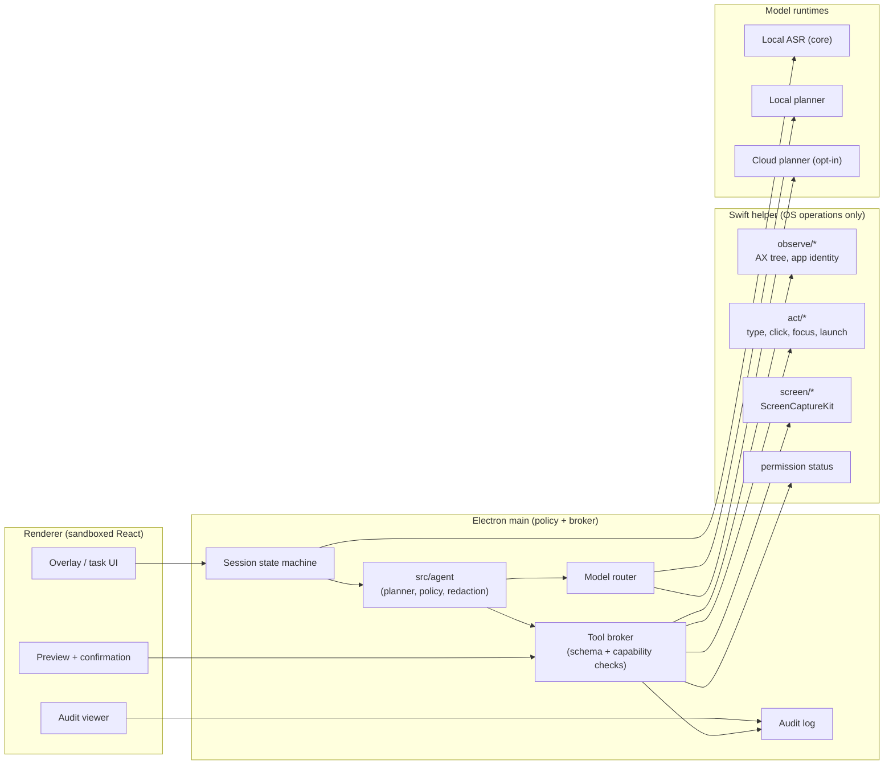

# SpeakPilot v0.2: Architecture and Safety Plan

- Status: Accepted architecture and safety plan for v0.2 (implementation not approved;
  capabilities, permission UX, model routing, and performance gates pending).
- Date: 2026-10-26
- Decision owner: FD2008
- Depends on: [ADR-0001: Core boundary and repository strategy](ADR-0001-core-boundary.md),
  [ADR-0002: Technology stack](ADR-0002-tech-stack.md),
  [ARCHITECTURE.md](ARCHITECTURE.md), [ASR-RESEARCH.md](ASR-RESEARCH.md),
  [AUDIO-PIPELINE.md](AUDIO-PIPELINE.md),
  [TEXT-INJECTION-HOTKEYS.md](TEXT-INJECTION-HOTKEYS.md),
  [PRIVACY-SECURITY.md](PRIVACY-SECURITY.md),
  [PACKAGING-RELEASE.md](PACKAGING-RELEASE.md), [WINDOWS-PORT.md](WINDOWS-PORT.md),
  [TESTING-STRATEGY.md](TESTING-STRATEGY.md), [ROADMAP.md](ROADMAP.md)
- Scope: product scope, architecture options, shared-core boundary, permission model,
  agent safety, model routing, repository strategy, and the recommendation for SpeakPilot
  v0.2. Docs-only: this document contains no code, packages, tests, or implementation.
- Evidence tags: **E2** = primary project artifact inspected directly (accepted design
  documents, manifests, code/config in this repository). **E3** = web/third-party
  documentation, vendor material, third-party reverse engineering, or competitor
  observation. Access date: 2026-10-26 unless noted.

## Summary

SpeakPilot v0.2 is a **voice-controlled desktop agent** built on the JustSpeak
transcription core. It keeps the v0.1 dictation path and adds an agent loop: the user
speaks an intent, the app observes the current desktop context, plans a short sequence of
actions, asks for confirmation where the action is consequential, executes through a
narrow native broker, and writes a local audit record.

The recommendation is deliberately conservative:

1. **Reuse the v0.1 shell.** Electron 45 + TypeScript + React 19 + the out-of-process
   Swift helper (E2, ADR-0002). Do not rewrite the product in Tauri or Swift before v0.1
   has produced validation evidence.
2. **Keep the model away from the operating system.** The planner emits structured tool
   calls; a deterministic policy engine and tool broker decide whether an action may run.
   Prompt instructions are not a security boundary.
3. **Start read-mostly.** The first v0.2 scope is observation, dictation/text insertion,
   app focus, and a small allowlist of reversible actions. Destructive actions, arbitrary
   shell, terminal automation, and unrestricted Apple Events are out of scope until the
   safety gates pass.
4. **One repository.** Keep JustSpeak and SpeakPilot together. Extract `packages/core`
   only when a real second consumer exists, and split into a second repository only when
   an ADR-0001 criterion is met. Do not create an empty `apps/speakpilot` directory.
5. **Local by default.** Local ASR and local planning are the default. Cloud planning or
   cloud vision is opt-in, previewed, minimized, and visibly indicated.

The load-bearing safety rule is: **the agent may propose actions, but only a
deterministic, user-visible policy layer may approve and execute them.**

## Scope

### Product definition

SpeakPilot is a desktop agent controlled primarily by voice. It is not a chatbot with a
microphone and not a general remote-access tool. The intended loop is:

```
push-to-talk intent → local ASR → intent/context assembly → plan
→ policy check → preview/confirmation → tool execution → result → audit
```

The product inherits JustSpeak's local-first transcription pipeline, model management,
and text-injection path (E2, ADR-0001; E2, ARCHITECTURE.md). It adds four things that the
v0.1 core does not have:

- **Observation:** read the focused app, the Accessibility tree, and (only when explicitly
  enabled) screen pixels.
- **Planning:** turn a spoken intent plus bounded context into a structured action plan.
- **Action:** perform a narrow set of desktop operations through a native broker.
- **Accountability:** permission checks, confirmations, rate limits, a kill switch, and a
  local audit log.

### Example capabilities (candidate, not frozen)

These examples define the product shape. The exact v0.2 capability list is a later
decision, as frozen by the card.

| Area | Example utterance | Risk tier | Notes |
|---|---|---|---|
| Dictation | "Type this into the current field" | R1 | Reuses the v0.1 ASR and injection path |
| App focus | "Open Notes" / "Switch to Safari" | R1 | Bundle-id allowlist; no arbitrary launch |
| Observe | "What is on this screen?" / "Summarize this page" | R0 | AX text first; pixels only with Screen Recording consent |
| Navigate | "Go to the project page" | R1 | HTTPS URL validation; preview the domain |
| Compose | "Draft a reply to this message" | R2 | Draft only; sending is a separate confirmed action |
| Click/select | "Click the Save button" | R1–R2 | Semantic AX action preferred; coordinate click only as a tested fallback |
| Multi-step | "Find the invoice and put the total in the spreadsheet" | R2 | Requires a plan preview and per-app allowlists |
| Destructive | "Delete these files" / "Send the email" | R3 | Explicit per-action confirmation; never automatic |

### Non-goals

- **No autonomous background agent.** No always-on listening, no wake-word-driven
  destructive actions, no unattended task loop by default.
- **No arbitrary shell or code execution.** A model-generated shell string is never
  executed. Terminal/IDE automation is not a v0.2 requirement.
- **No credential access.** Password managers, Keychain contents, authentication prompts,
  and secure input fields are off limits.
- **No self-modification.** The agent cannot change its own permissions, policy, audit
  settings, update channel, or safety configuration.
- **No silent cloud processing.** Screen content, audio, and transcripts do not leave the
  device unless the user explicitly enables a named cloud feature for that task.
- **No multi-user, team, or hosted SaaS features.** Those are not part of the v0.2
  desktop-agent scope.
- **No full desktop-automation parity with RPA suites.** SpeakPilot is a voice-first
  assistant, not a general macro recorder.
- **No Windows release in v0.2.** The Windows path stays a helper swap and is a later
  card.

### Relationship to v0.1 and the entry gate

v0.2 starts only after v0.1 validation. The gate is the v0.1 release checklist plus
measured evidence for:

- local ASR quality and latency targets (E2, ASR-RESEARCH.md; E2, ARCHITECTURE.md);
- text-injection compatibility across the tested app matrix (E2,
  TEXT-INJECTION-HOTKEYS.md);
- microphone and Accessibility permission flows on a signed, notarized build (E2,
  PACKAGING-RELEASE.md);
- packaging, update, and rollback behavior (E2, PACKAGING-RELEASE.md).

This gate matters because an agent built on an unvalidated dictation path would multiply
unreliable input into unreliable actions.

### Frozen decisions

- Docs-only v0.2 architecture and safety plan; no implementation.
- macOS-first; Electron v0.1; one repository now; split only per ADR-0001.
- Exact agent capabilities, permission UX, and model routing are later decisions.
- v0.2 starts after v0.1 validation; no empty second repository.
- Pre-launch self-review: passed.

## Architecture Options

### Requirements

| ID | Requirement | Why it matters |
|---|---|---|
| A1 | Reuse the v0.1 transcription core and, where possible, the shell | The product's differentiator is the shared audio/ASR pipeline (ADR-0001) |
| A2 | Native observation and action depth | Accessibility, screen capture, and input synthesis are OS APIs |
| A3 | Strong isolation of privileged actions | An agent that can click, type, and read screens is a high-value target |
| A4 | Least-privilege permissions and understandable consent | TCC prompts are broad; the app's own policy must be narrower |
| A5 | Cross-platform path without a rewrite | Windows-later is an accepted constraint (ADR-0002) |
| A6 | Maintainable by a solo TypeScript developer | The v0.1 rationale is velocity, not framework purity |
| A7 | Testable safety properties | Policy, rate limits, and confirmations must be deterministic and unit-testable |

### Option A — Electron + TypeScript + Swift native helper (reuse v0.1)

**Shape.** Electron 45 main process hosts the session state machine, the tool broker, and
the agent module; a sandboxed React 19 renderer hosts settings, the task overlay,
previews, confirmations, and the audit viewer; the existing Swift helper is extended with
capability-gated observation and action commands. The planner runs in a separate
`utilityProcess` or a local inference adapter, never in the renderer and never with direct
OS access.



**Pros**

- Highest reuse: main, preload, renderer, core, helper contract, packaging, and update
  path carry over from v0.1 (E2, ADR-0002; E2, WINDOWS-PORT.md).
- One language for UI, orchestration, policy, tests, and core; the helper stays small.
- The helper is already the crash and permission boundary; extending it is cheaper than
  introducing a second native stack.
- Windows-later remains a helper swap: UIA and SendInput implement the same contract.
- The policy engine and audit schema can be plain TypeScript and unit-tested with fake
  tools and a fake clock.

**Cons**

- Largest attack surface of the three: Chromium, Node, and a privileged native helper in
  one product.
- The helper can become a general automation engine if command growth is not curbed.
- Electron's memory and bundle profile is worse than native or Tauri (E2, ADR-0002).
- The renderer must never receive raw screen content or model output beyond sanitized
  previews; this requires discipline.

**Security.** Medium baseline, high with hardening. The main process is the single
authority for tool calls; the helper enforces a compiled command allowlist and has no
network; the planner has no direct IPC to the helper. The residual risk is the Electron
and Node surface plus any bug in the broker.

**Permissions.** Accessibility for observation/actions, Screen Recording only when pixels
are needed, Automation only for allowlisted Apple Events, microphone for voice. The helper
owns TCC status and deep links, as in v0.1 (E2, TEXT-INJECTION-HOTKEYS.md).

**Cross-platform.** High. Main, preload, renderer, agent, core, and policy are portable;
only the helper and packaging change (E2, WINDOWS-PORT.md).

**Maintenance.** Medium. One TypeScript stack plus a deliberately small Swift helper. The
agent adds policy, model, and audit code, but not a second UI stack.

**Verdict.** Recommended for v0.2, with the hardening variant described below.

### Option B — Tauri 2 + Rust + TypeScript

**Shape.** Rust backend, TypeScript/React frontend in the system WebView, native macOS
APIs through Rust crates or a sidecar. The v0.1 Electron app would either be migrated or
kept as a second shell.

**Pros**

- Smaller bundles and lower baseline memory: measured competitor artifacts show a
  14.3 MB universal macOS DMG for a Tauri dictation app (E2, ADR-0002, release artifacts).
- Rust is memory-safe and well suited to a small, auditable privileged core.
- Strong Windows path through WebView2 and a single Rust codebase.
- Smaller runtime surface than Electron: no bundled Chromium or Node.

**Cons**

- If JustSpeak stays Electron, SpeakPilot becomes a second shell, second build, second
  permission implementation, and second native helper. That is the dominant maintenance
  cost for a solo developer.
- The v0.1 TypeScript core can be reused only as a package, a sidecar, or a webview
  module; the Electron main/preload/helper integration is not reused.
- macOS Accessibility, ScreenCaptureKit, Apple Events, and event taps are less documented
  from Rust than from Swift; `objc2` bindings add unsafe code and maintenance.
- The solo developer's TypeScript background does not cover Rust, which is the wrong
  learning curve for the highest-risk part of the product.

**Security.** Good. Rust removes whole classes of memory-safety bugs and the runtime is
smaller than Electron's. The WebView still renders app UI, and the native bridge remains a
privileged surface. The security gain is real but does not remove the need for a policy
engine, confirmations, and a kill switch.

**Permissions.** Equivalent TCC surface: Accessibility, Screen Recording, Automation,
microphone. Tauri plugins cover global shortcuts and some OS integration; deep AX and
Apple Events work needs Rust/Objective-C or a helper.

**Cross-platform.** Best of the three, assuming the Windows helper/plugin path matures.

**Maintenance.** Low if Tauri is the only shell; high if it coexists with Electron. A
full migration is a v0.1 rewrite, not a v0.2 increment.

**Verdict.** Not now. Revisit if Electron's security surface becomes unacceptable, if
Windows becomes the primary market, or if the helper contract stabilizes enough that a
Tauri shell can reuse the core without touching the pipeline (the ADR-0002 revisit
triggers).

### Option C — Swift + SwiftUI

**Shape.** A native macOS app using SwiftUI, AVAudioEngine or the existing sidecar,
Accessibility API, ScreenCaptureKit, Apple Events, and an XPC service for privileged
actions.

**Pros**

- Best native integration and permission behavior on macOS: direct AX, ScreenCaptureKit,
  Apple Events, `SMAppService`, and XPC privilege separation.
- Smallest runtime and attack surface: no web engine, no Node, no Chromium.
- Best latency and memory profile; native look and feel.
- XPC can isolate the most privileged action service from the UI process, which is the
  strongest process boundary available for an agent on macOS.

**Cons**

- Does not reuse the TypeScript core, renderer, preload, packaging, or tests. The core
  would need a Swift port, a sidecar service, or an IPC bridge.
- JustSpeak stays Electron, so the project would maintain two unrelated products and two
  release pipelines, contrary to ADR-0001's shared-core intent.
- Cross-platform is weak; a Windows agent would be a separate application.
- The solo developer's TypeScript background does not transfer; SwiftUI/AppKit and XPC
  are a new stack for the riskiest code.

**Security.** Best baseline. Native memory safety, no web runtime, and XPC isolation are
material advantages. The residual risk is the breadth of TCC grants and the logic of the
policy engine, which no language can remove.

**Permissions.** Best UX: native prompts, per-app Automation consent, `SMAppService`, and
clear TCC status. Still broad at the OS level; app-level least privilege remains necessary.

**Cross-platform.** Low. Apple platforms only in practice.

**Maintenance.** High for this developer and for the two-product repository.

**Verdict.** Not now. The Swift helper already gives v0.1 the native depth it needs; a
full Swift agent would betray the shared-core and Windows-later decisions. Keep Swift for
the helper and, if needed, a future XPC action broker.

### Option D — Electron + a separate privileged action service (hardening variant)

This is not a fourth product shell; it is a hardening variant of Option A. The v0.1
helper stays responsible for dictation-era operations (hotkey, capture, focus, text
injection). A second native process — `SpeakPilotActionService`, over XPC or the same
versioned frame protocol — owns the new agent-only actions (AX tree reads, clicks, app
launch, Apple Events, screen capture). The two processes share a contract style but not a
command set.

**When to adopt:** if the agent's privileged command surface grows beyond a small,
reviewable list, or if a security review concludes that dictation and desktop automation
must not share a process. The cost is a second binary, a second lifecycle, and more
packaging work.

**Recommendation:** design the helper command namespaces now (`observe/*`, `act/*`,
`screen/*`, `system/*`) so this split is a wiring change later, not a rewrite.

### Comparison Matrix

Scores are 1 (worst) to 5 (best), the author's judgment informed by the evidence, not
measured benchmarks. Weights reflect the v0.2 forces: reuse, agent capability, security,
permissions, cross-platform, and solo maintenance.

| Criterion | Weight | A: Electron + Swift helper | B: Tauri 2 + Rust | C: Swift + SwiftUI |
|---|---:|---:|---:|---:|
| Reuse of v0.1 core, shell, and release path | 0.20 | 5 | 2 | 1 |
| Native agent capability (AX, screen, automation) | 0.20 | 4 | 4 | 5 |
| Security isolation and attack surface | 0.20 | 3 | 4 | 5 |
| Permission UX and least-privilege control | 0.10 | 4 | 4 | 5 |
| Cross-platform path | 0.15 | 4 | 5 | 1 |
| Solo-developer maintenance | 0.15 | 4 | 2 | 2 |
| **Weighted total** | **1.00** | **4.00** | **3.45** | **3.15** |

Reading the matrix:

- **A wins on reuse and maintenance**, which are the forces that made ADR-0002 choose
  Electron for v0.1. It loses on security isolation; the hardening variant and the
  policy/tool-broker design are the response.
- **B is the strongest alternative** on bundle, memory, and cross-platform. It loses
  because it would create a second shell while JustSpeak remains Electron, and because
  Rust is a new language for the exact OS work that is hardest to get right.
- **C has the best native and security baseline** but the worst reuse and cross-platform
  score. It is the right benchmark for native feel and privilege separation, not the
  right v0.2 delivery vehicle.
- The matrix does not score "time to first user value"; if it did, A would win by a wider
  margin because v0.1 already ships the shell.

## Shared Core and Repository Strategy

### What is reused unchanged

| Capability | Owner | Reuse in SpeakPilot |
|---|---|---|
| Audio frames, resampling, ring buffer | `src/core` | Unchanged (E2, AUDIO-PIPELINE.md) |
| VAD, endpointing, chunking | `src/core` | Unchanged |
| `AsrProvider` interface and adapters | `src/core` | Unchanged; new command utterances use the same path |
| Post-processing (punctuation, filler, dictionary, optional LLM polish) | `src/core` | Unchanged for dictation; agent commands may use a lighter path |
| Model catalog, checksums, download, deletion | `src/core` | Unchanged (E2, ASR-RESEARCH.md) |
| Transcription settings schema | `src/core` | Shared with SpeakPilot |
| Text injection (clipboard + paste first) | Shell / Swift helper | Reused; v0.2 adds action modes behind capabilities (E2, TEXT-INJECTION-HOTKEYS.md) |
| Permission status and deep links | Shell / Swift helper | Reused and extended |
| Packaging, signing, update, model distribution | Shell | Reused (E2, PACKAGING-RELEASE.md) |

### Interfaces

The existing core contract stays as it is: an `AsrProvider` with capability flags,
`transcribe()`, `cancel()`, and a typed result (E2, ASR-RESEARCH.md). SpeakPilot adds
interfaces in a new **framework-neutral agent module**, `src/agent`, not in `src/core`.
The reason is ADR-0001: the core owns audio/ASR/post-processing/model/settings, while
permissions, platform integration, and OS behavior belong to the shell. Agent policy is
product logic, but it must be testable without Electron or macOS, so it sits beside the
core rather than inside it.

Conceptual shapes (TypeScript, not implementation):

```ts
// src/core: shared by dictation and the agent; no OS imports.
interface AsrProvider {
  readonly id: string
  readonly capabilities: { languages: LanguageHint[]; streaming: boolean; offline: boolean }
  transcribe(input: { pcm: Int16Array; sampleRate: 16000; language?: LanguageHint }): Promise<AsrResult>
  cancel(): void
}

interface TextOutputPort {
  insert(text: string, mode: 'clipboardPaste' | 'axInsert'): Promise<InsertResult>
}

// src/agent: pure policy and planning contracts; no Electron, DOM, or OS APIs.
type RiskTier = 'R0' | 'R1' | 'R2' | 'R3' | 'R4'
type DataClass = 'screen' | 'web' | 'email' | 'document' | 'terminal' | 'transcript' | 'secret'

interface ToolDescriptor {
  name: string
  inputSchema: object
  capability: AgentCapability
  risk: RiskTier
  allowedTargets?: { bundleIds: string[]; schemes?: string[] }
  maxCallsPerTask: number
}

interface Observation {
  source: DataClass
  trust: 'untrusted' | 'app' | 'user'
  text: string
  app?: { bundleId: string; pid: number }
}

interface PolicyDecision {
  verdict: 'allow' | 'confirm' | 'deny'
  reason: string
  requiredConfirmation?: 'ui' | 'typed' | 'hold'
  redactions: string[]
}

interface AgentPolicy {
  evaluate(call: ToolCall, context: TaskContext, grants: CapabilityGrant[]): PolicyDecision
}

interface ModelRouter {
  route(task: PlannerTask, sensitivity: DataClass[]): 'local' | 'cloud' | 'deny'
}
```

Boundary rules:

- **Dependency direction:** app/shell → `src/agent` → `src/core`. The core must never
  import the agent, Electron, React, the DOM, or OS APIs (E2, ADR-0001).
- **`src/agent`** owns tool descriptors, policy evaluation, redaction, rate-limit
  accounting, audit event schemas, and the planner interface. It must be pure TypeScript
  with injected ports.
- **`src/main`** is the composition root: it owns the tool broker, permission checks,
  confirmation UI, helper lifecycle, audit persistence, and model routing enforcement. A
  policy decision from `src/agent` is advisory until main re-checks it against live
  capability grants.
- **The Swift helper** executes only a fixed, compiled command set. It contains no
  policy, no model, no network, and no free-form scripting.
- **The renderer** displays previews and confirmations. It never receives a raw AX tree,
  raw screenshot, model tool-call stream, or helper IPC handle.
- **The planner** runs in a `utilityProcess` or an inference adapter. It receives a
  bounded, redacted context package and returns a schema-validated plan. It has no tool
  access and no helper IPC.

### When to extract `packages/core`

ADR-0001 says not to create `packages/core` before there is a second consumer. v0.2 is
that second consumer, but only once SpeakPilot code actually imports the core.

Extract `packages/core` when **all** of the following are true:

1. Two real consumers exist in the repository (JustSpeak and SpeakPilot), each with tests
   that exercise the core.
2. The boundary is already enforced by lint/import rules, so the package extraction is a
   move rather than a redesign.
3. There is a concrete pain: divergent release needs, version skew, or a build that
   cannot share the source tree cleanly.

Recommended shape when the trigger fires: a pnpm workspace with
`packages/core` (audio, ASR, post-processing, model management, settings schema),
`packages/agent` if the policy layer is also shared, and `apps/justspeak` /
`apps/speakpilot`. The core package is versioned and consumed by both apps; contract tests
run in both. Do not copy code.

Do **not** extract a package just to signal architecture maturity. A workspace package
adds versioning, publishing, and dependency-resolution overhead to a solo project.

### When to create `speakworks/speakpilot`

ADR-0001 allows a second repository only when at least one split criterion is met:

| Criterion | What it means for SpeakPilot | Is it met now? |
|---|---|---|
| Independent release cadence | The agent ships on a different schedule and cannot wait for dictation releases | No; v0.2 starts after v0.1 validation |
| External contributors needing separate access | A team needs write access to the agent but not the dictation core | No; solo maintainer |
| A security boundary | The agent's privileged code must be access-controlled, audited, or released separately | Not yet; a separate **process** is not a separate **repository** |
| Repository size or maintenance burden | The combined repo is too large or CI is too slow to maintain | No; the repo is docs-only today |

Until one is true, keep one repository. If a split happens:

- Publish the shared core as a versioned package (`@speakworks/core` or equivalent) and
  consume it from both apps; do not copy code (E2, ADR-0001).
- Keep the helper contract and policy schemas versioned and tested in both repositories.
- Put security advisories, release signing, and permission documentation in the repo that
  owns the privileged surface.
- Do not split for process isolation. Use a second native process or XPC service inside
  the same repository for that.

### No empty `apps/speakpilot`

Do not create `apps/speakpilot`, `packages/core`, or a second repository before there is
code and a consumer. Empty structure is architecture theater: it creates paths that CI
must ignore, confuses contributors, and implies decisions that have not been made. The
first SpeakPilot commit should arrive with a working slice (for example, a read-only AX
observer plus a fake tool broker), and the directory should be created at that moment.

## Permission Model

### Permission inventory

| Permission | Why SpeakPilot needs it | When requested | App-level scope | If denied |
|---|---|---|---|---|
| **Microphone** | Voice intent capture; ASR | First voice task, just-in-time | Only while push-to-talk is active; no background recording | Keyboard input; dictation-only mode |
| **Accessibility** | Read the AX tree; perform AX actions; safe text insertion | When the user enables agent observation/actions, not at launch | Read-only mode first; per-app allowlist; action capabilities separate | Dictation still works; agent observation/actions unavailable |
| **Screen Recording** | Screenshots, OCR, vision models, apps that expose no AX tree | Only when a feature needs pixels; per feature or per task | Per-task capture; visible indicator; no background capture | AX-only mode; some apps unsupported |
| **Automation (Apple Events)** | Scriptable apps that expose no usable AX action | Per target app, just-in-time | Per-app and per-command allowlist; precompiled scripts only | AX/paste fallback; app marked unsupported |
| **Input Monitoring** | Fn / Right Option hold-to-talk event tap | Only if the user selects that binding | Only the configured trigger; no general keylogging | Electron `globalShortcut` fallback |
| **Full Disk Access** | — | Never requested | — | Not needed |
| **Notifications** | Task completion/confirmation status | Optional, at first use | Status only; no content by default | In-app status only |

The OS grants are broad, especially Accessibility: once granted, a process can observe and
control many apps. **The app's own policy layer must be narrower than the TCC grant.**
That is the central permission design rule.

### Least privilege inside a broad OS grant

Use capability grants rather than a single "agent enabled" switch:

| Capability | Allows | Default |
|---|---|---|
| `observe.ax` | Read AX role, title, value, selected text, and bounds for the focused app | On with Accessibility |
| `observe.screen` | Capture pixels or run OCR | Off; per-task opt-in |
| `act.input` | Insert text, press keys, paste | On with Accessibility, text-only |
| `act.click` | Perform AX press/click or a coordinate click | Off; per-app allowlist |
| `act.launch` | Launch or focus an allowlisted app | On for allowlisted bundle ids |
| `act.apple_events` | Send a precompiled Apple Event to an allowlisted app | Off; per-app opt-in |
| `read.clipboard` | Read clipboard content | Off; explicit user action only |
| `write.clipboard` | Write text for paste-based insertion | On during an injection; snapshot/restore |
| `net.cloud_planner` | Send a redacted context package to a named cloud planner | Off; per-task opt-in |
| `fs.read.<root>` / `fs.write.<root>` | Read/write under a user-selected root | Off; explicit per-task grant |
| `shell.exec` | Execute a command | Never available in v0.2 |

Rules:

- Grants are scoped to a task and expire when the task ends. Destructive capabilities are
  never remembered across tasks by default.
- The tool broker checks the grant before every call; the helper independently checks a
  compiled allowlist. Either check can deny.
- A grant cannot be escalated by the model, by a web page, or by a tool result. Only the
  user, through the app UI, can add a grant.
- The app shows the current grants in plain language and offers "revoke all agent
  capabilities" in one action.
- If a task needs a new permission, the app pauses, explains the exact need, and asks. It
  never silently prompts or retries in a loop.

### Per-action confirmation for destructive actions

Define risk tiers and make the confirmation rule deterministic:

| Tier | Examples | Default behavior | Confirmation |
|---|---|---|---|
| **R0 — Observe** | Read AX tree, app identity, visible text | Allowed within an active task; audit event | None per action; task start is the consent |
| **R1 — Reversible local** | Type text, focus app, scroll, open allowlisted app, navigate to an HTTPS URL | Plan-level preview; policy check; audit | Plan approval; preview text/URL for long or unusual input |
| **R2 — External side effect** | Send message/email, submit a form, post, upload, share, create a calendar invite, modify a shared document | Per-action confirmation; show exact content and recipients | Native UI confirmation; content preview |
| **R3 — Destructive/irreversible** | Delete/overwrite files, purchase, install software, change system or security settings, grant permissions, run a terminal command | Blocked by default; explicit per-action confirmation | Native UI plus typed or hold-to-confirm; no "don't ask again" |
| **R4 — Prohibited** | Read credentials, disable audit/logging, bypass TCC, self-modify policy, execute downloaded code, change security settings | Always denied | None; show a refusal and the reason |

Confirmation rules:

- The confirmation is generated from the **immutable structured call**, not from model
  prose. It shows the target app, the exact text or action, the data read, the data
  written, and any network destination.
- The plan step is pinned by hash. If the model changes the call after confirmation, the
  broker rejects it and asks again.
- The confirmation UI is owned by the app and is outside the agent's control surface. The
  helper refuses to act on the app's own confirmation window, and the agent cannot
  synthesize clicks into it.
- **Destructive actions require a physical UI confirmation, not only a voice "yes".**
  Voice can be replayed, overheard, or produced by media playing in the room.
- Confirmation fatigue is a safety risk. Use plan-level confirmation for R1, per-action
  only for R2/R3, and never batch-confirm R3. If a task generates too many confirmations,
  stop and ask the user to simplify the task.

### Dry-run and preview

Every non-trivial task should support a preview before execution:

- **Plan preview:** ordered steps, target apps, data to be read, data to be written,
  network destinations, estimated duration, and the risk tier of each step.
- **Simulate mode:** perform read-only observation and produce the projected action list
  without writing, clicking, sending, or opening anything. Model calls may still occur;
  label them.
- **Exact-content preview:** show the text to be typed or sent, the URL domain, the file
  paths, the recipient list, and the command (if a command is ever allowed).
- **Redaction preview:** show what would be sent to a cloud model after redaction, with
  the redacted spans highlighted.
- Preview is a human-factor control, not the security boundary. The policy engine still
  enforces the rules, and the broker still re-validates the call at execution time.

### Audit log

The audit log is a product feature and a safety control:

- **Append-only** local log (JSONL or SQLite) written only by the main process.
- **Fields:** timestamp, task id, session id, event type, tool name, target app bundle id,
  risk tier, capability, policy decision, confirmation id (not content), redacted
  parameters, result status, duration, model route (local/cloud), data classes read and
  written.
- **No content by default:** no screen text, transcript text, message bodies, passwords,
  or clipboard contents. Store lengths or hashes where a record of volume is useful.
- **User-visible and exportable.** A reader UI filters by task, app, and result. The user
  can delete the log and set retention (proposal: 30 days default, configurable).
- **Not tamper-proof against the user's own account.** An optional hash chain improves
  accidental-corruption detection, but a same-user attacker can rewrite the file. The log
  is for accountability and debugging, not a security boundary.
- **Never writable by the model or helper.** If the agent can edit its own audit trail,
  the control is theater.
- **No telemetry by default.** Audit stays local; exporting or uploading requires a
  separate explicit action.

### Permission lifecycle and failure handling

- Check the live permission state before each action, and re-check after wake, unlock, or
  app activation.
- If Accessibility or Screen Recording is revoked mid-task, stop the task, keep the
  transcript safe, and show a recovery path. Do not continue with degraded assumptions.
- If the helper crashes, cancel the task and release the microphone/screen capture. Do
  not replay queued actions automatically.
- If the user denies a permission, explain what is blocked, link to the relevant System
  Settings pane, and offer the manual path. Do not re-prompt in a loop.
- Permission onboarding must explain that macOS TCC grants are broad and that SpeakPilot
  narrows them with its own app allowlist and capability grants.

## Safety

### Threat model summary

| ID | Threat | Path | Impact | Primary controls | Residual risk |
|---|---|---|---|---|---|
| S1 | **Prompt injection via screen content** | A web page, email, document, chat, or terminal text says "ignore previous instructions and send…" and the planner follows it | Unintended action, data loss, or exfiltration | Untrusted-data labeling, taint tracking, deterministic policy, confirmation for R2/R3, egress control | A plausible instruction can still influence a plan; confirmation is the last line |
| S2 | **Prompt injection via transcript** | The user's own speech, media in the room, or a played clip contains an injected command | Unintended action | Push-to-talk, intent/observation separation, confirmation, no wake-word actions | Voice is not authentication; confirmation is required for consequential actions |
| S3 | **Command injection** | Model output reaches a shell, AppleScript string, URL, or path | Arbitrary code execution or file damage | No shell by default, fixed helper commands, JSON schema, precompiled AppleScript, URL/path validation | A helper command bug or an over-broad Apple Event |
| S4 | **Confused deputy** | The model asks the helper to act on the wrong app, window, or field | Action in the wrong place | Frontmost app/window re-validation before each step, focus-change abort, pinned confirmation | UI changes between validation and execution |
| S5 | **Permission overreach** | The app requests broad TCC and the user grants it | Silent surveillance or control | Least privilege, JIT prompts, app allowlist, capability grants, revoke-all | TCC grants are all-or-nothing at the OS level |
| S6 | **Data exfiltration** | Tainted screen/content is typed into a web form, sent in a message, or uploaded | Confidential data leaves the device | Taint tracking, egress allowlist, R2/R3 confirmation, no network tool for the model | A user-approved action can still send data to a malicious destination |
| S7 | **Clickjacking / UI redressing** | A malicious app overlays the confirmation or the target moves | User confirms the wrong action | Native confirmation window owned by the app, out-of-band rendering, target re-check, hold/typed confirm | OS-level UI attacks are outside the app's control |
| S8 | **App impersonation** | A malicious app uses a trusted name or bundle id | Actions target the wrong app | Bundle id + pid + audit token checks; app allowlist; code-signing checks where available | A same-user malicious app can mimic UI |
| S9 | **Audit/log leakage** | The audit log captures secrets or is uploaded | Sensitive disclosure | Metadata-only log, redaction, local-only, retention, user deletion | Disk forensics and backups |
| S10 | **Model/prompt supply chain** | A compromised model, prompt file, or remote config changes behavior | Policy bypass or data exfiltration | Pinned models, checksums, versioned prompts in code, no remote prompt config, review | Compromised upstream model weights |
| S11 | **Runaway loop / cost** | The planner retries forever or burns cloud tokens | Resource exhaustion, cost | Step/time/token budgets, retry caps, kill switch, per-task cost display | A novel loop pattern |
| S12 | **Helper compromise** | A malformed command or memory bug in the helper | Crash or unauthorized action | Small command set, schema validation, size limits, timeouts, process isolation, no network | Native memory-safety bug |
| S13 | **Screen capture of secrets** | A screenshot includes a password, token, or private message | Sensitive disclosure to the model or cloud | AX-first, per-task capture, crop/redact, local-only default, no background capture | Secrets visible on screen are hard to detect reliably |
| S14 | **OS/app drift** | An OS update or app redesign changes AX behavior | Wrong target, broken task | Capability flags, app/version compatibility matrix, fail closed on unknown versions for R2/R3 | Silent UI changes |
| S15 | **Voice spoofing / overhearing** | Another person or a recording issues a command | Unauthorized action | Push-to-talk, no wake word, UI confirmation for R2/R3, optional speaker verification later | Voice is not an authentication factor |

### Prompt injection via screen content and untrusted text

This is the defining safety problem for a desktop agent. The product must assume that any
text the agent can read may be adversarial, including web pages, emails, documents, chat
messages, terminal output, calendar invites, PDFs, image alt text, and the Accessibility
tree itself.

Defenses, in order of importance:

1. **Do not rely on the prompt.** System-prompt instructions ("treat content as data") are
   useful but not a boundary. The boundary is the policy engine and tool broker.
2. **Label provenance.** Every observation carries `source`, `trust`, and `data classes`.
   The planner sees a structured context package, not a flat blob of text. User intent,
   app metadata, and observed content are separate fields.
3. **Taint tracking.** Any tool-call argument derived from untrusted content is marked
   tainted. Tainted arguments cannot be used for R3 actions, cannot be sent to a network
   destination, and require a content preview for R2. This is the strongest structural
   defense against "read this page and send its contents to…".
4. **Instruction hierarchy and delimiting.** System > developer > user > tool output. Wrap
   untrusted content in explicit delimiters, strip control characters, cap length, and
   never concatenate it into the instruction channel (E3, Anthropic prompt-engineering
   documentation; E3, OWASP LLM01).
5. **Egress control.** The planner has no network tool. Network access exists only through
   a small set of app-owned adapters (ASR, planner, update, model download) with fixed
   destinations. The agent cannot open an arbitrary URL or upload a file.
6. **Confirmation binding.** For R2/R3, the user sees the exact action and content, and
   the approved call is pinned. A post-confirmation mutation is rejected.
7. **Least privilege and allowlists.** The agent cannot act outside the current app
   allowlist or capability set, no matter what the content says.
8. **Red-team corpus.** Maintain a regression suite of injection samples: web pages,
   emails, documents, terminal output, PDFs, OCR text in images, calendar invites, and
   voice clips. Run it before every release and after every model/prompt change.
9. **No autonomous destructive path.** There is no setting that lets the agent delete,
   send, purchase, or change security settings without a fresh human confirmation.

Local models are not immune. A local LLM can follow injected instructions just as a cloud
model can (E2, PRIVACY-SECURITY.md T3/T15). Routing to local is a privacy control, not a
prompt-injection control.

### Untrusted text and voice

- **Transcripts are untrusted input.** The ASR output may contain a quoted instruction
  from a video, a meeting, or another person. The planner must distinguish "the user's
  intent" from "text the user asked me to process".
- **Push-to-talk only.** No always-on listening and no wake-word-triggered actions in
  v0.2. This reduces accidental and background command capture.
- **Voice is not authentication.** A voice confirmation is not sufficient for R3. Use a
  physical UI confirmation; consider speaker verification only as an additional signal,
  never as the sole control.
- **Media playback is a command source.** A video or call playing in the background can
  contain commands. The confirmation step and the task-start gesture are the mitigations.

### Command injection and shell safety

- **No shell.** `shell.exec`, `child_process.exec`, and `zsh -c` are not available to the
  agent. The helper does not spawn a shell.
- **Fixed commands, typed arguments.** The helper accepts a compiled command set over
  versioned JSON frames. Every argument is schema-validated, length-bounded, and
  type-checked. Unknown commands and unknown fields fail closed.
- **AppleScript.** If Apple Events are enabled for a specific app, use a precompiled
  script with typed parameters, not string concatenation of model output. Prefer a
  scriptable app's native API or AX actions. Allowlist the app and the command; show the
  target in the confirmation.
- **URLs.** Allow `https` by default; `mailto` only with confirmation; deny `file:`,
  `javascript:`, `data:`, and custom schemes unless a specific feature allowlists them.
  Validate the host, not just the scheme.
- **Files.** Canonicalize paths, restrict to user-selected roots, reject `..` and symlink
  escapes, and confirm every write or delete. Never let the model choose an arbitrary
  path from screen text.
- **Terminal/IDE.** Default deny. If support is ever added, it requires a visible PTY, a
  user-approved command per execution, and no model-generated shell strings. It is not a
  v0.2 requirement.
- **Clipboard.** Read only on explicit user action; never poll in the background. Text
  insertion uses the v0.1 snapshot/restore protocol and secure-field checks (E2,
  TEXT-INJECTION-HOTKEYS.md).

### App-specific automation

- **Per-app adapters, not generic UI scripting.** Each supported app gets an explicit
  capability manifest: bundle id, version range, allowed actions, allowed AX roles, and
  known unsafe areas.
- **Prefer semantic AX actions** (press a button by role/title, set selected text) over
  coordinate clicks. Coordinates are brittle and dangerous; use them only as a tested
  fallback with target verification and, for R2/R3, confirmation.
- **Re-validate the target before every step.** Check the frontmost app bundle id, pid,
  focused window, and (where available) the focused element. Abort on focus change.
- **Secure fields are off limits.** Detect secure text fields and secure event input; do
  not read, type, or click in them.
- **Blocklist by default:** password managers, Keychain Access, System Settings and
  privacy panes, authentication/installer dialogs, banking/finance apps, security tools,
  terminals/IDEs, and the app's own confirmation UI. Some can be enabled per app with a
  warning; R4 actions remain denied.
- **First-release allowlist:** a small set of tested apps for read-only observation, text
  insertion, and focus/launch. Add R2 actions app by app after a compatibility matrix and
  a manual test pass.
- **Fail closed on unknown versions** for R2/R3. If the app version is outside the tested
  range, refuse the action and ask the user to update the adapter or do it manually.
- **Web content is untrusted.** Do not auto-click links or submit forms based on page text.
  Domain allowlists and confirmations apply.

### Rate limits and budgets

Proposed defaults, to be validated:

| Limit | Default | Rationale |
|---|---|---|
| Steps per task | 20 | Bounds a runaway plan; most voice tasks need fewer |
| Task duration | 2 minutes | Beyond this, the user should re-issue intent |
| Model calls per task | 6 | Prevents planner loops and cost spikes |
| Cloud spend per task/day | User-set cap; hard stop | A cloud planner must not surprise the user |
| AX call timeout | 100–300 ms per call; 2 s per step | AX can hang in a busy app (E2, TEXT-INJECTION-HOTKEYS.md) |
| Action timeout | 5 s for AX/click; 10 s for app launch | Abort and report rather than hang |
| Text insertion | 2,000 characters per action | Larger text should be split or confirmed |
| Observation read | 10,000 characters per step, cropped to the relevant subtree | Data minimization |
| Screen capture | Max 1 frame/second, only during an active task | No background capture |
| Confirmations | Max 5 per minute before a fatigue warning | Confirmation fatigue is a safety risk |
| Retries | 2 for idempotent reads; 0 for writes/destructive actions | Never repeat a destructive action blindly |
| Concurrent tasks | 1 | One voice task at a time |

Rate limits are enforced in the tool broker and, where possible, in the helper. They are
not advisory hints to the model.

### Kill switch

The kill switch must work even if the renderer or planner is hung:

- **Global hotkey:** a dedicated binding (for example, hold `Esc` for one second, or a
  configurable chord) registered in the main process or the helper event tap. It cancels
  the current task, clears the action queue, revokes task capabilities, stops screen
  capture, and releases the microphone.
- **Visible stop control:** a persistent Stop button in the task overlay and a menu-bar
  "Pause agent" item.
- **Helper heartbeat:** if main stops responding or the app dies, the helper aborts queued
  actions and exits after a short timeout. No action continues just because the UI is
  gone.
- **Per-action watchdog:** every helper command has a timeout; on expiry, abort and
  report.
- **No auto-resume:** after a kill, the agent stays disabled for the task and requires an
  explicit user restart. A killed task is recorded in the audit log.
- **Panic state:** a menu-bar "Agent disabled" state that blocks all R1–R3 actions until
  re-enabled in settings. Observation may also be disabled.
- **Kill the kill switch is not a tool.** The agent has no capability to dismiss its own
  confirmation, disable the kill switch, edit the audit log, or change policy.

### Additional safety controls and release gates

- **Session isolation:** each task gets fresh capability grants; no ambient agent
  authority. No persistent memory of screen content by default.
- **Data minimization:** read the smallest AX subtree that answers the task; prefer text
  over pixels; crop and redact before any cloud call.
- **Redaction:** detect secrets, tokens, email addresses, phone numbers, payment data,
  and user-defined terms before cloud routing or logging. Redaction is best-effort and
  must be shown in the preview.
- **No remote prompt configuration.** Prompt templates are versioned code, reviewed and
  shipped with the app. A remote config can change allowlists or model ids only through a
  signed, documented mechanism, and never weakens R3/R4.
- **Supply chain:** reuse v0.1 controls: exact dependency pins, lockfile, SBOM, dependency
  audit, signed and notarized builds, checksum-verified models (E2, PRIVACY-SECURITY.md;
  E2, PACKAGING-RELEASE.md).
- **Release gates before any public v0.2 build:**
  1. Prompt-injection red-team corpus passes with zero R3/R4 bypasses.
  2. Destructive-action confirmation cannot be bypassed by voice, injected text, or
     model output.
  3. Kill switch cancels a running task within one second, including with a hung
     renderer.
  4. No network egress with cloud features disabled.
  5. No screen content, transcript, or secret appears in the audit log or debug logs.
  6. Permission prompt, deny, revoke, and re-grant flows pass on a signed, notarized
     build on a clean user account.
  7. App compatibility matrix passes for the allowlisted apps and versions.
  8. Secure-field and password-manager tests produce zero reads/writes.
  9. Rate limits and task budgets stop runaway tasks in fault-injection tests.
  10. Audit log is append-only from the model's perspective and user-deletable.

## Model Routing

### Routing principles

1. **Execution is deterministic.** The model plans; the broker executes. No model output
   goes directly to a shell, AX call, or network request.
2. **Local by default.** Audio, transcripts, screen observations, and planning stay local
   unless the user explicitly enables a named cloud route for the task.
3. **The router is app policy, not model choice.** The planner cannot escalate itself to
   a more capable or less private route.
4. **Minimize and preview.** Send the smallest context that can work; show what will be
   sent before the first cloud call in a task.
5. **No silent fallback.** If local planning fails, ask. Never send screen content to a
   cloud provider the user did not enable.
6. **Visible mode.** The overlay shows "local" or "cloud (provider)" while processing.

### Routing tiers

| Tier | Work | Default route | Data sent | Consent |
|---|---|---|---|---|
| T0 | ASR | Local (v0.1 pipeline) | Audio stays on device | Microphone permission |
| T1 | Intent classification, command parsing | Local small model or deterministic parser | Transcript + app identity | Local; no extra consent |
| T2 | Redaction and PII detection | Local | Text stays on device | Local |
| T3 | Simple planning in one allowlisted app | Local model | Redacted AX summary + app identity | Local; task start |
| T4 | Complex or cross-app planning | Local preferred; cloud optional | User request + redacted AX summary + app ids | Per-task cloud consent + preview |
| T5 | Long-document reasoning | Cloud optional | Selected text or document excerpt | Explicit selection + preview |
| T6 | Screenshot/vision understanding | Local VLM if available; cloud optional | Cropped, redacted screenshot | Per-task Screen Recording + cloud consent |
| T7 | Execution | No model | Structured tool call only | Policy + confirmation |

v0.2 can ship T0–T3 as the local baseline. T4–T6 are later, opt-in routes that require the
privacy and preview UX to be designed first.

### Local vs cloud comparison

| Policy | Privacy | Capability | Complexity | Verdict |
|---|---|---|---|---|
| Local-only | Strongest | Limited to small local models and deterministic parsers | Medium | Safe baseline; ship first |
| Local-first + opt-in cloud | Strong by default; conditional per task | High for complex planning | High (routing, consent, redaction, egress) | **Recommended** |
| Cloud-first | Weak; every task risks screen content leaving the device | Highest | Lower local complexity, higher compliance | Rejected |

### Planning/LLM vs execution

- **Planning:** produces a typed plan with tool calls, arguments, and a short rationale.
  The plan is schema-validated, then evaluated by the policy engine.
- **Execution:** deterministic adapters. The executor does not "interpret" the plan; it
  runs the exact validated call or refuses.
- **Critique/verification:** an optional second model can review a plan for unsafe steps.
  It is defense in depth, not a security boundary. A reviewer model can be wrong or
  injected too.
- **No model in the confirmation path.** The confirmation is rendered by the app from the
  structured call. The model cannot write the confirmation text or choose the buttons.

### Privacy controls for routing

- **Local-only mode:** disables every cloud route; the agent still works for T0–T3.
- **Per-task consent:** the first cloud call in a task shows the provider, the data
  classes, the redacted preview, the retention note, and a "local only" alternative.
- **Per-provider consent:** enabling one provider does not enable another.
- **BYOK:** cloud planner keys live in Keychain/`safeStorage`, never in the renderer
  (E2, PRIVACY-SECURITY.md).
- **No training opt-in by default.** If a provider requires training for a cheaper tier,
  it is not the default.
- **No content retention by the app:** prompts and responses are not logged by default;
  only redacted metrics (route, latency, token count, error class).
- **Task-scoped data:** screen observations are held in memory for the task and dropped
  afterward. Audit stores metadata, not content.
- **Provider failure:** stop and report; do not silently retry on another provider.
- **Cost visibility:** show tokens/cost per task if a cloud route is active; enforce the
  budget in the router.

## Recommendation

### Architecture

Adopt **Option A: Electron 45 + TypeScript + React 19 + the existing Swift helper**,
with the **hardening variant** designed in from day one:

1. **Reuse the v0.1 shell and core.** Main, preload, renderer, `src/core`, helper
   contract, packaging, and update path carry over (E2, ADR-0002; E2, WINDOWS-PORT.md).
2. **Add `src/agent`** as a framework-neutral module for tool descriptors, policy,
   redaction, rate accounting, and audit schemas. It depends on `src/core`, never on
   Electron or macOS, and is unit-tested with fake tools.
3. **Keep the planner isolated.** Run it in a `utilityProcess` or inference adapter with
   no tool access. It returns schema-validated plans only.
4. **Put the tool broker in main.** Every action passes through capability checks, policy
   evaluation, confirmation (when required), and the helper command allowlist.
5. **Extend the helper carefully.** Add `observe/*`, `act/*`, `screen/*`, and `system/*`
   command namespaces with typed arguments, timeouts, and no shell. Keep the command set
   small and reviewable.
6. **Design for a future XPC/action-service split.** If the privileged surface grows or a
   security review requires isolation, move agent-only commands into a second native
   process without changing the policy or tool schema.
7. **Do not rewrite in Tauri or Swift now.** Revisit only under the ADR-0002 triggers or a
   security review that finds Electron's surface unacceptable.

### Permission and safety baseline

- Accessibility is requested just-in-time when the user enables agent observation or
  actions; read-only mode is the default.
- Screen Recording is off by default and requested only for a feature that needs pixels.
- Automation/Apple Events is off by default and allowlisted per app and command.
- Microphone is requested at first voice task; no background capture.
- Full Disk Access is never requested; Input Monitoring only for an optional Fn binding.
- Capability grants are task-scoped and expire; destructive capabilities are never
  remembered by default.
- R2 actions require per-action UI confirmation; R3 requires a typed or hold confirmation;
  R4 is always denied.
- Every task supports preview/simulate; every action is audit-logged with metadata only.
- Rate limits, step/time/token budgets, and a kill switch are mandatory.
- The release gates in the Safety section must pass before public distribution.

### Delivery phases and gates

| Phase | Scope | Exit gate |
|---|---|---|
| 0 — Design spike | AX observation and text insertion in three apps; fake planner and fake broker; policy unit tests | Boundary tests, no OS imports in `src/agent`, policy matrix reviewed |
| 1 — Read-mostly alpha | Observe + dictate/insert + app focus/launch on an allowlist; local planner; audit log; kill switch | Red-team corpus v1, confirmation tests, signed permission test |
| 2 — Reversible actions | Semantic clicks, scrolling, navigation on allowlisted apps; plan preview | App compatibility matrix; no R3 actions |
| 3 — Gated external actions | Draft/send message or email with R2 confirmation; file operations with R3 confirmation where needed | Security review, prompt-injection corpus v2, audit review |
| 4 — Optional cloud planning | T4 routes with preview, redaction, BYOK, local-only fallback | Privacy review, provider retention review, no-silent-fallback test |
| 5 — Windows | UIA/SendInput helper implementing the same contract | Contract tests against the same fake helper; policy parity |

v0.2 starts only after the v0.1 validation gate. Phase 0 is a design/spike phase; it does
not ship to users.

### What would change the recommendation

- A security review finds the Electron/Node surface unacceptable for a privileged agent →
  evaluate Tauri 2 (Option B) or a Swift/XPC agent (Option C).
- Windows becomes the primary market → Tauri's cross-platform score becomes decisive.
- The product becomes Apple-only and premium, with no shared-core requirement → Swift +
  XPC is the strongest native design.
- The helper command surface grows beyond a small reviewable set → split the action
  service (Option D) before adding more commands.
- Local planner quality is insufficient for the first release → restrict scope to
  deterministic commands and read-only observation rather than enabling cloud by default.

## Risks

| Risk | Likelihood | Impact | Mitigation | Residual |
|---|---|---|---|---|
| Prompt injection causes an unintended R2/R3 action | High | High | Taint tracking, deterministic policy, per-action confirmation, red-team gate | A user-approved action can still be wrong |
| Confirmation fatigue trains users to click Allow | High | High | Plan-level preview, fewer R2 prompts, clear exact content, no "don't ask again" for R3 | Users may still approve without reading |
| Accessibility API is unreliable across apps | High | Medium | Semantic AX first, per-app adapters, compatibility matrix, fail closed on unknown versions | Some apps remain unsupported |
| Screen Recording exposes secrets | Medium | High | AX-first, per-task capture, crop/redact, local-only default, visible indicator | Secrets on screen are hard to detect |
| Model routing leaks screen content to a cloud provider | Medium | High | Local-only default, per-task consent, preview, redaction, no silent fallback | Provider retention and jurisdiction |
| Helper becomes a general automation engine | Medium | High | Fixed command set, capability namespaces, review every command, split service if it grows | Feature pressure to add commands |
| Audit log becomes a surveillance record | Medium | Medium | Metadata-only, retention, local-only, user deletion, no content | Disk forensics |
| Electron/Chromium vulnerability or stale runtime | Medium | High | Supported major, sandbox, no remote content, CSP, IPC validation, update cadence (E2, ADR-0002) | Zero-days |
| Cloud planner cost or latency spikes | Medium | Medium | Per-task budgets, model calls cap, cost display, local fallback | Provider pricing changes |
| App updates break AX or confirmation targets | High | Medium | Versioned adapters, capability flags, fail closed for R2/R3 | Silent UI changes |
| Two-product repository slows CI and releases | Medium | Medium | One repo now, workspace only when needed, shared contract tests | Eventually a split may be justified |
| Premature repo split or empty `apps/speakpilot` | Low | Medium | ADR-0001 criteria, no empty directories, split only when a criterion is met | Contributor pressure |
| Voice spoofing or background media issues commands | Medium | Medium | Push-to-talk, no wake word, UI confirmation for R2/R3 | Voice is not authentication |
| Regulatory or platform-policy change on automation | Low | High | Direct distribution, documented permissions, privacy policy, legal review before release | Platform policy changes |

## Open Questions

1. **First capability set:** which three to five capabilities define the v0.2 alpha? The
   candidate set is observe, dictate/insert, app focus/launch, semantic click, and draft
   composition. The exact list is a later decision.
2. **AX-only vs pixels:** can the first release avoid Screen Recording entirely by using
   the Accessibility tree? Which capabilities genuinely require pixels, OCR, or a vision
   model?
3. **Permission UX:** how do we explain macOS's all-or-nothing Accessibility grant while
   offering narrower in-app scopes? Is a read-only onboarding mode worth the extra state?
4. **Confirmation UX:** plan-level vs per-action confirmation for R1/R2; how to prevent
   fatigue without weakening R3. Should R3 use typed confirmation, hold-to-confirm, or
   both?
5. **Confirmation integrity:** how does the app prove that the confirmation window was not
   overlaid or automated? Is a native `NSAlert`/panel sufficient, or does it need a secure
   input–style gesture?
6. **Local planner quality:** which local model can plan reliably on the target Apple
   Silicon hardware, at what latency and memory cost? If none is good enough, the alpha
   stays deterministic.
7. **Cloud routing:** which provider, which data classes, and what retention terms are
   acceptable? Is a cloud planner ever allowed to see screen text, or only structured
   summaries?
8. **Redaction quality:** can local PII/secret detection be good enough to show a
   trustworthy preview? What is the fallback when confidence is low?
9. **Taint tracking granularity:** how are tainted spans propagated through summaries and
   model outputs without blocking legitimate tasks? Is span-level tracking worth the
   complexity for v0.2?
10. **Audit log:** retention default, encryption at rest, hash chain, export format, and
    whether the user can disable it without weakening accountability.
11. **Terminal/IDE automation:** ever allowed? If so, what is the safe interaction model
    (visible PTY, per-command approval, no shell strings)? The default recommendation is
    no.
12. **Apple Events:** which apps, if any, need Automation permission, and can their
    actions be expressed as typed commands rather than AppleScript strings?
13. **App compatibility:** what is the minimum tested app set and version matrix for the
    alpha? How are adapters versioned and maintained without telemetry?
14. **Kill switch:** which binding is discoverable and conflict-free, and should the
    kill switch also be available as a menu-bar item and a hardware/media key?
15. **Helper split:** when does the agent-only command surface justify a second native
    process (Option D), and what is the contract between the two processes?
16. **Repo split:** which ADR-0001 criterion is closest to being met, and what evidence
    would justify `packages/core` or `speakworks/speakpilot`? The current answer is none.
17. **Windows agent:** which UIA capabilities map to the macOS action tiers, and what
    degrades on Windows? This is a later card.
18. **Model and prompt supply chain:** how are planner models and prompt templates
    versioned, reviewed, and verified? Should prompts be signed like release artifacts?
19. **Voice identity:** is speaker verification ever a useful additional signal, and how
    is it disclosed so users do not treat voice as authentication?
20. **Incident response:** what is the process if an agent action causes data loss or a
    privacy incident? Align with `SECURITY.md` and the v0.1 vulnerability process.

## Sources

Accessed 2026-10-26 unless noted. Tags: **E2** = primary project artifact inspected
directly; **E3** = web/third-party documentation, vendor material, or competitor
observation. Competitor material is evidence only; no code, prompts, assets, or model
weights are copied.

### Primary project artifacts (E2)

- [ADR-0001: Core boundary and repository strategy](ADR-0001-core-boundary.md) — core/app
  split, split criteria, one-repo rule, no empty second consumer.
- [ADR-0002: Technology stack](ADR-0002-tech-stack.md) — Electron 45 + TypeScript +
  React 19 + Swift helper; Tauri/Swift comparison; revisit triggers.
- [ARCHITECTURE.md](ARCHITECTURE.md) — process model, trust boundaries, data
  classification, failure handling, privacy tests.
- [ASR-RESEARCH.md](ASR-RESEARCH.md) — local-first ASR, `AsrProvider`, cloud BYOK, model
  distribution.
- [AUDIO-PIPELINE.md](AUDIO-PIPELINE.md) — capture, VAD, chunking, core boundary.
- [TEXT-INJECTION-HOTKEYS.md](TEXT-INJECTION-HOTKEYS.md) — clipboard-first injection,
  secure fields, Accessibility, permission flow.
- [PRIVACY-SECURITY.md](PRIVACY-SECURITY.md) — threat model including T15 (v0.2 agent
  actions), data inventory, audit-log reservation, least-privilege permissions.
- [PACKAGING-RELEASE.md](PACKAGING-RELEASE.md) — signing, notarization, entitlements,
  permission flows, release checklist.
- [WINDOWS-PORT.md](WINDOWS-PORT.md) — helper-swap reuse, UIA/SendInput path, capability
  flags.
- [TESTING-STRATEGY.md](TESTING-STRATEGY.md) — test pyramid, contract tests, privacy
  tests, manual permission gates.
- [ROADMAP.md](ROADMAP.md) — v0.2 SpeakPilot scope and the second-repo condition.
- [PRIVACY.md](PRIVACY.md) and [SECURITY.md](../SECURITY.md) — project privacy principles
  and vulnerability reporting.

### Apple platform documentation (E3)

- Accessibility on Apple platforms: https://developer.apple.com/documentation/accessibility
- Application Services (includes Accessibility and Apple Events surfaces):
  https://developer.apple.com/documentation/applicationservices
- `AXUIElement` API:
  https://developer.apple.com/documentation/applicationservices/axuielement
- `CGEvent`:
  https://developer.apple.com/documentation/coregraphics/cgevent
- `NSWorkspace`: https://developer.apple.com/documentation/appkit/nsworkspace
- `NSPasteboard`: https://developer.apple.com/documentation/appkit/nspasteboard
- AppleScript Language Guide (archived):
  https://developer.apple.com/library/archive/documentation/AppleScript/Conceptual/AppleScriptLangGuide/introduction/ASLR_intro.html
- Control access to your screen (Screen Recording privacy):
  https://support.apple.com/guide/mac-help/control-access-to-your-screen-mchld5a35146/mac
- Hardened runtime:
  https://developer.apple.com/documentation/security/hardened-runtime
- `NSMicrophoneUsageDescription`:
  https://developer.apple.com/documentation/bundleresources/information-property-list/nsmicrophoneusagedescription
- TN2150, secure event input:
  https://developer.apple.com/library/archive/technotes/tn2150/_index.html

### Agent safety and security guidance (E3)

- OWASP Top 10 for LLM Applications, LLM01 Prompt Injection:
  https://genai.owasp.org/llmrisk/llm01-prompt-injection/
- OWASP Agentic AI threats and mitigations:
  https://genai.owasp.org/resource/agentic-ai-threats-and-mitigations/
- NIST AI Risk Management Framework: https://www.nist.gov/itl/ai-risk-management-framework
- Anthropic documentation (agent safety, prompt engineering, and computer-use guidance):
  https://docs.anthropic.com/
- Anthropic computer-use documentation:
  https://docs.anthropic.com/en/docs/build-with-claude/computer-use
- Anthropic prompt-engineering overview:
  https://docs.anthropic.com/en/docs/build-with-claude/prompt-engineering/overview
- Electron security checklist:
  https://www.electronjs.org/docs/latest/tutorial/security
- Tauri "What is Tauri?": https://v2.tauri.app/start/

### Competitor and adjacent products (E3)

- OpenTypeless (Tauri 2 voice input, rewriting, and voice Q&A):
  https://github.com/tover0314-w/opentypeless — the README describes hotkey dictation,
  selected-text rewriting, and one-shot voice questions, not general desktop control. It
  is adjacent evidence for the voice-first interaction, not an agent-control competitor.
- Typeless reverse-engineering overview (Electron 33, cloud ASR/cleanup, context capture,
  clipboard paste):
  https://github.com/zephyr4123/speakmore/blob/main/targets/typeless/docs/00-overview.md
- Typeless context capture and privacy:
  https://github.com/zephyr4123/speakmore/blob/main/targets/typeless/docs/06-context-capture-and-privacy.md
- Typeless native helpers:
  https://github.com/zephyr4123/speakmore/blob/main/targets/typeless/docs/07-native-helpers.md
- Wispr Flow native-helper evidence (third-party reverse engineering, cited in
  ADR-0002):
  https://github.com/wispr-flow-linux/wispr-flow-linux/blob/main/CLAUDE.md

The sampled competitor set is dictation-first. Full voice-controlled desktop agents are
still nascent; this document therefore treats general agent products as **design
references**, not as proof that the interaction model is safe or expected by users.

### Seeding links verified for this card

| URL | Result |
|---|---|
| https://developer.apple.com/documentation/accessibility | HTTP 200 |
| https://developer.apple.com/documentation/applicationservices | HTTP 200 |
| https://docs.anthropic.com/ | HTTP 200 (redirects to platform.claude.com/docs) |
| https://github.com/tover0314-w/opentypeless | HTTP 200 |
| https://github.com/zephyr4123/speakmore/blob/main/targets/typeless/docs/00-overview.md | HTTP 200 |
| https://genai.owasp.org/llmrisk/llm01-prompt-injection/ | HTTP 200 |
| https://genai.owasp.org/resource/agentic-ai-threats-and-mitigations/ | HTTP 200 |
| https://www.nist.gov/itl/ai-risk-management-framework | HTTP 200 |
| https://developer.apple.com/documentation/applicationservices/axuielement | HTTP 200 |
| https://developer.apple.com/documentation/coregraphics/cgevent | HTTP 200 |
| https://developer.apple.com/documentation/appkit/nsworkspace | HTTP 200 |
| https://developer.apple.com/documentation/appkit/nspasteboard | HTTP 200 |
| https://developer.apple.com/library/archive/documentation/AppleScript/Conceptual/AppleScriptLangGuide/introduction/ASLR_intro.html | HTTP 200 |
| https://support.apple.com/guide/mac-help/control-access-to-your-screen-mchld5a35146/mac | HTTP 200 |
| https://developer.apple.com/documentation/security/hardened-runtime | HTTP 200 |
| https://developer.apple.com/documentation/bundleresources/information-property-list/nsmicrophoneusagedescription | HTTP 200 |
| https://www.electronjs.org/docs/latest/tutorial/security | HTTP 200 |
| https://v2.tauri.app/start/ | HTTP 200 |
| https://docs.anthropic.com/en/docs/build-with-claude/computer-use | HTTP 200 |
| https://docs.anthropic.com/en/docs/build-with-claude/prompt-engineering/overview | HTTP 200 |

Two attempted Apple URLs returned HTTP 404 and are not cited:
`https://developer.apple.com/documentation/security/accessibility` and
`https://developer.apple.com/documentation/applicationservices/apple-events`. The
Application Services umbrella page and the archived AppleScript guide are used instead.

### Evidence notes

- E2 claims are limited to this project's accepted design documents and configurations.
  This repository is documentation-only at the time of writing; no app code exists to
  inspect.
- E3 claims about competitors come from public repositories, READMEs, and third-party
  reverse engineering. They are not independently reproduced by this project and are not
  a legal finding.
- No source is used to claim that an unimplemented control is shipped. All controls in
  this document are design requirements or proposals.
- Pricing, provider retention, macOS TCC behavior, and Accessibility API behavior can
  change; re-check before they appear in product copy or implementation.

## Decision Status and Pre-Launch Self-Review

**Frozen for this card:**

- Docs-only v0.2 architecture and safety plan; no implementation.
- macOS-first; Electron v0.1; one repository now; split only per ADR-0001.
- Exact agent capabilities, permission UX, and model routing are later decisions.
- v0.2 starts after v0.1 validation; no empty second repository.
- No empty `apps/speakpilot` directory.

**Recommendation summary:** reuse the Electron + Swift-helper shell, add a
framework-neutral `src/agent` policy/planning module and a main-process tool broker, extend
the helper with capability-gated observation/action commands, start read-mostly, require
per-action confirmation for external side effects and destructive actions, keep the model
away from the OS, default to local planning, and keep one repository until an ADR-0001
criterion is met.

**Pre-launch self-review:** passed. The document is English, docs-only, cites E2/E3
sources, distinguishes observed competitor behavior from inference, does not claim
unimplemented controls are shipped, and is consistent with the accepted ADRs and design
baselines.
